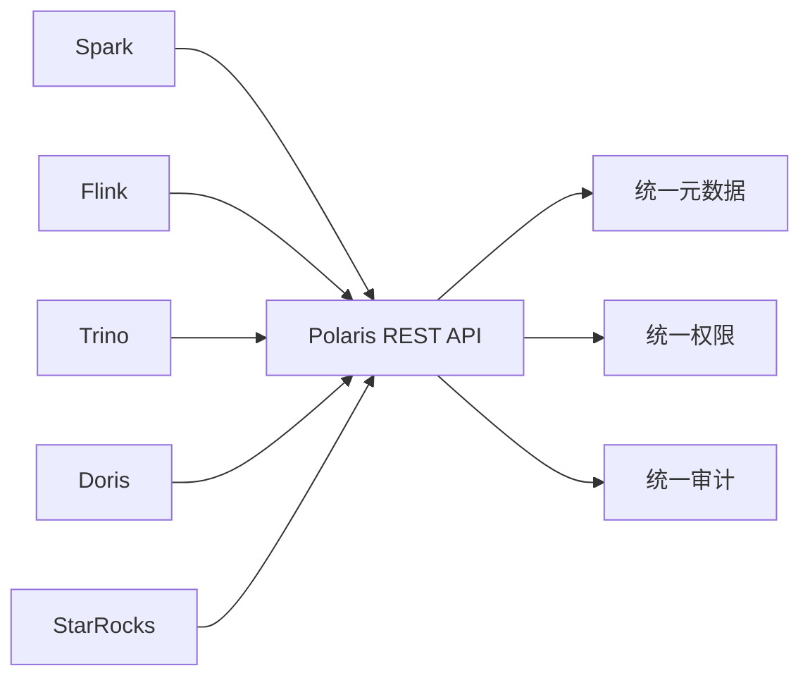
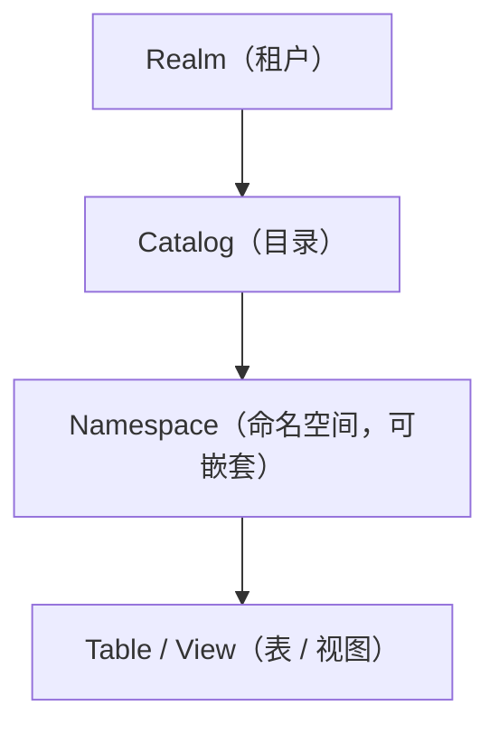
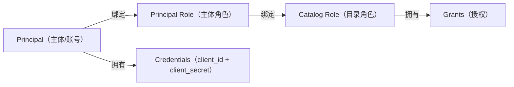
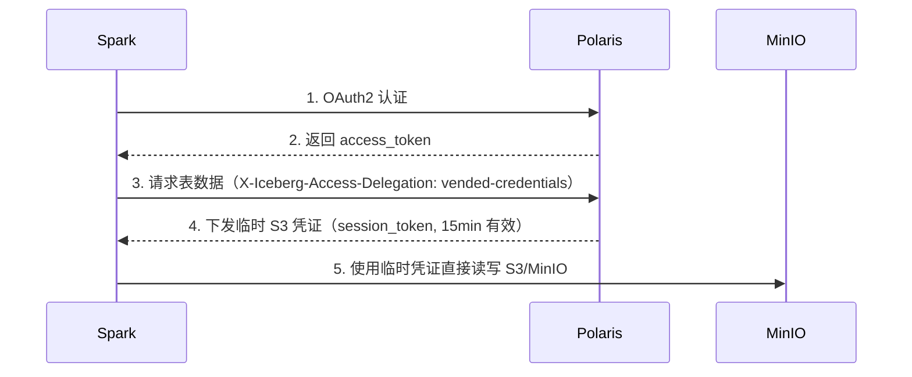

# Apache Polaris 介绍

## 一、Polaris介绍

**定义**：Apache Polaris是一个**开源的、全功能的Apache Iceberg REST Catalog实现**。它实现了Iceberg REST Catalog开放协议，为各种计算引擎提供集中式、安全的Iceberg表读写访问能力

Apache Polaris是Iceberg表的"元数据管理中心"，Apache Polaris不存储数据本身，而是管理"哪些表在哪里、谁能访问、怎么访问"

Apache Polaris解决的是Iceberg表管理的痛点：

- 引擎孤岛：Spark用HMS，Trino用JDBC Catalog，各引擎无法共享表
- 权限混乱：每个引擎各自管理权限，无法统一控制
- 无审计
- 扩展困难：新增引擎需要重新配置所有元数据

Apache Polaris通过统一的Rest API解决了所有问题



**核心特性**

| 特性                     | 说明                                                    |
| ---------------------- | ----------------------------------------------------- |
| **Iceberg REST 协议**    | 实现标准 Iceberg REST Catalog API，任何兼容引擎即插即用              |
| **多引擎互操作**             | Spark、Flink、Trino、Doris、StarRocks、Dremio 等共享同一份表      |
| **细粒度 RBAC**           | 基于角色的访问控制，精确到 Catalog/Namespace/Table 级别              |
| **Credential Vending** | 服务端下发临时存储凭证，客户端无需存储 AK/SK                             |
| **多存储后端**              | 支持 S3、GCS、Azure Blob、MinIO、Ozone、Ceph 等               |
| **多持久化后端**             | PostgreSQL、CockroachDB、MongoDB                        |
| **多租户（Realm）**         | 支持多租户隔离                                               |
| **Federation**         | 联邦外部 Catalog（Hive Metastore、BigQuery、其他 REST Catalog） |
| **可观测性**               | 内置 Prometheus 指标、OpenTelemetry 追踪                     |

## 二、核心概念

### 2.1 实体模型



**Realm（域/租户）**

- Polaris 的最顶层隔离单元
- 每个 Realm 有独立的用户、权限、Catalog
- 默认 Realm 名为 `POLARIS`
- 通过 HTTP Header `Polaris-Realm` 或配置默认值来路由

**Catalog（目录）**

- 一组 Iceberg 表的逻辑容器
- 绑定一个存储位置（如 S3 Bucket）
- 类型：
  - `INTERNAL`：Polaris 自身管理元数据
  - `EXTERNAL`：联邦外部 Catalog

**Namespace（命名空间）**

- 类似数据库中的 Schema/Database
- 支持多层嵌套（如 `prod.finance.transactions`）
- 用于组织表的逻辑分组

**Table / View**

- 标准的 Iceberg Table 或 View
- 元数据由 Polaris 管理
- 数据文件存储在绑定的对象存储中

### 2.2 安全模型（RBAC）



**实体说明**

| 实体                 | 说明                 | 类比           |
| ------------------ | ------------------ | ------------ |
| **Principal**      | 一个可认证的身份（用户或服务）    | 员工账号         |
| **Principal Role** | 一组 Principal 的角色集合 | 岗位（如"数据工程师"） |
| **Catalog Role**   | 在某个 Catalog 内的角色   | 项目权限组        |
| **Grant**          | 具体的权限授予            | 门禁卡（能进哪个房间）  |

**权限列表（Grants）**

| 权限 | 作用范围 | 说明 |
|------|----------|------|
| `CATALOG_MANAGE_ACCESS` | Catalog | 管理 Catalog 的访问控制 |
| `CATALOG_MANAGE_CONTENT` | Catalog | 管理 Catalog 的所有内容（建/删表等） |
| `CATALOG_MANAGE_METADATA` | Catalog | 管理 Catalog 元数据 |
| `CATALOG_READ_PROPERTIES` | Catalog | 读取 Catalog 属性 |
| `CATALOG_WRITE_PROPERTIES` | Catalog | 修改 Catalog 属性 |
| `NAMESPACE_CREATE` | Catalog/Namespace | 创建命名空间 |
| `NAMESPACE_DROP` | Namespace | 删除命名空间 |
| `NAMESPACE_LIST` | Namespace | 列出命名空间 |
| `NAMESPACE_READ_PROPERTIES` | Namespace | 读取命名空间属性 |
| `NAMESPACE_WRITE_PROPERTIES` | Namespace | 修改命名空间属性 |
| `TABLE_CREATE` | Namespace | 创建表 |
| `TABLE_DROP` | Table | 删除表 |
| `TABLE_LIST` | Namespace | 列出表 |
| `TABLE_READ_DATA` | Table | 读取表数据 |
| `TABLE_WRITE_DATA` | Table | 写入表数据 |
| `TABLE_READ_PROPERTIES` | Table | 读取表属性 |
| `TABLE_WRITE_PROPERTIES` | Table | 修改表属性 |
| `VIEW_CREATE` | Namespace | 创建视图 |
| `VIEW_DROP` | View | 删除视图 |
| `VIEW_LIST` | Namespace | 列出视图 |
| `REPORT_WRITE_METRICS` | Table | 上报写入指标 |

**权限继承**

权限是**向下继承**的：

```text
CATALOG_MANAGE_CONTENT（Catalog 级别）
  → 自动拥有该 Catalog 下所有 Namespace 和 Table 的全部权限
```

**凭证下发**

Polaris Credential Vending（安全）：
1. Spark 用 Polaris 凭证（client_id:secret）认证
2. Polaris 验证权限后，生成临时 S3 凭证（STS Token）
3. Spark 用临时凭证访问 S3（有效期短，自动过期）
4. 客户端无需存储任何 S3 AK/SK



## 三、与其他Catalog对比

| 特性                 | Polaris      | Hive Metastore | AWS Glue   | Nessie     | JDBC Catalog |
| ------------------ | ------------ | -------------- | ---------- | ---------- | ------------ |
| 协议                 | Iceberg REST | Thrift         | AWS SDK    | Nessie API | JDBC         |
| 多引擎支持              | ✅ 原生         | ⚠️ 需适配         | ⚠️ AWS 生态  | ✅          | ⚠️           |
| RBAC               | ✅ 细粒度        | ❌              | ⚠️ IAM     | ⚠️         | ❌            |
| Credential Vending | ✅            | ❌              | ✅          | ❌          | ❌            |
| 多租户                | ✅ Realm      | ❌              | ⚠️ Account | ❌          | ❌            |
| Federation         | ✅            | ❌              | ❌          | ❌          | ❌            |
| 开源                 | ✅ Apache 2.0 | ✅              | ❌          | ✅          | ✅            |
| 云无关                | ✅            | ✅              | ❌ AWS Only | ✅          | ✅            |
| 生产就绪               | ✅            | ✅              | ✅          | ✅          | ⚠️           |

## 四、生态工具

| 工具                           | 说明                                           |
| ---------------------------- | -------------------------------------------- |
| **Polaris Console**          | Web 管理界面（社区工具）                               |
| **Polaris MCP Server**       | Model Context Protocol 服务器，供 AI 助手操作 Polaris |
| **Iceberg Catalog Migrator** | 从 Hive/Glue/JDBC 迁移到 Polaris                 |
| **Polaris Synchronizer**     | 跨 Polaris 实例同步元数据                            |
| **Polaris Benchmarks**       | 性能基准测试工具                                     |
