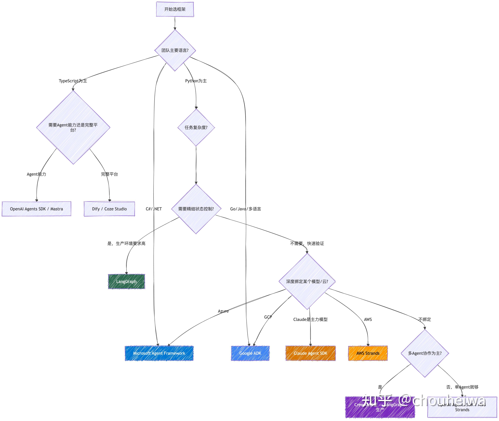

# Hive → Iceberg 数据迁移文档（保留 Hive 仓库完整可用）

> 配套文档：《Iceberg-1.11.0-部署文档.md》
> 环境：hadoop105 客户端节点（Spark 4.1.3 / Flink 2.1.3 / Iceberg 1.11.0）；Hive 3.1.3 在 hadoop102
> 迁移后 Iceberg 数据落在**新存储位置** `hdfs://hadoop102:8020/warehouse/iceberg`

---

## 1. 迁移目标与总原则

- **目标**：把 Hive 数仓中的表迁移为 Iceberg 格式，数据写入新存储位置
- **硬性要求**：迁移完成后，Hive 数据仓库**原样保留、和以前完全一样可用**（表名不变、数据不动、可继续正常读写）
- 基于该要求的方式选型：

| 方式              | 是否采用 | 角色          | 对 Hive 侧影响                                        |
| --------------- | ---- | ----------- | ------------------------------------------------- |
| **CTAS 复制**     | ✅    | **正式迁移方案**  | 零改动，彻底解耦                                          |
| **snapshot 快照** | ✅    | **迁移前验证手段** | 零改动（共享引用源文件，只读验证用）                                |
| ~~migrate~~     | ❌    | 不采用         | 会把源表改名 _BACKUP_ 并接管原表名，改变了 Hive 侧，不符合本需求          |
| ~~add_files~~   | ❌    | 不采用         | 文件归 Iceberg 所有，expire_snapshots 会物理删除 Hive 目录下的文件 |

> 一句话：**snapshot 用来"先试"，CTAS 用来"真迁"**。

---

## 2. 迁移前准备

### 2.1 让 Spark 能看到 Hive 仓库的表

```bash
# 把 Hive 配置放进 Spark classpath（spark_catalog 才能映射到 Hive 仓库）
cp /opt/module/hive-client-conf/hive-site.xml /opt/module/spark/conf/
```

验证（hadoop105 上执行 `spark-sql --master yarn`）：

```sql
SHOW DATABASES IN spark_catalog;
SHOW TABLES IN spark_catalog.hive_db;    -- hive_db 换成你的实际库名
```

### 2.2 确认 Iceberg catalog 可用

部署文档已配置名为 `iceberg` 的 catalog（warehouse = `hdfs://hadoop102:8020/warehouse/iceberg`）：

```sql
SHOW DATABASES IN iceberg;
CREATE DATABASE IF NOT EXISTS iceberg.iceberg_db;   -- 目标库，按规划命名
```

### 2.3 盘点源表（建迁移清单）

对每张待迁移表执行：

```sql
DESCRIBE EXTENDED spark_catalog.hive_db.表名;
```

记录以下信息，决定迁移路径：

| 检查项                            | 处理方式                          |
| ------------------------------ | ----------------------------- |
| 格式 Parquet / ORC / Avro / Text | 直接 CTAS（CTAS 不限格式，Spark 能读即可） |
| `transactional=true`（ACID 表）   | Spark 读不了，走 6.1 节特殊处理         |
| 分桶表                            | CTAS 不受限，桶语义见 6.3 节           |
| 分区字段                           | 记下来，3.2/3.3 节要用               |

---

## 3. 方式一：CTAS 复制（正式迁移）

> 原理：`CREATE TABLE ... AS SELECT` 把 Hive 表数据**复制**成 Iceberg 表的新文件，写入
> `/warehouse/iceberg` 新位置。源表全程零改动，迁移后两套数据完全独立、互不影响。

### 3.1 小表 / 非分区表：一次性复制

```sql
CREATE TABLE iceberg.iceberg_db.orders
USING iceberg
TBLPROPERTIES ('format-version'='2')
AS SELECT * FROM spark_catalog.hive_db.orders;
```

### 3.2 分区表：保留分区结构

```sql
CREATE TABLE iceberg.iceberg_db.dwd_trade
USING iceberg
PARTITIONED BY (dt)
TBLPROPERTIES ('format-version'='2')
AS SELECT * FROM spark_catalog.hive_db.dwd_trade;
```

> 说明：`PARTITIONED BY (dt)` 是 identity 分区，与 Hive 分区一一对应；
> 后续可利用 Iceberg 分区演进（如 `days(dt)`）无损优化，无需重写数据。

### 3.3 大表：按分区分批复制（生产推荐）

避免单个大任务超时/OOM，先建空表再逐分区灌数：

```sql
-- 1) 用 WHERE 1=0 秒建同构空表
CREATE TABLE iceberg.iceberg_db.dwd_trade
USING iceberg
PARTITIONED BY (dt)
AS SELECT * FROM spark_catalog.hive_db.dwd_trade WHERE 1=0;

-- 2) 逐分区灌数
INSERT INTO iceberg.iceberg_db.dwd_trade
SELECT * FROM spark_catalog.hive_db.dwd_trade WHERE dt = '2026-07-20';
```

批量脚本 `batch_copy.sh`（自动遍历所有分区）：

```bash
#!/bin/bash
SRC=spark_catalog.hive_db.dwd_trade
DST=iceberg.iceberg_db.dwd_trade
for p in $(spark-sql --master yarn -e "SHOW PARTITIONS $SRC" 2>/dev/null | grep -o 'dt=[^/|]*' | cut -d= -f2 | sort -u); do
  echo "===== copying partition dt=$p ====="
  spark-sql --master yarn -e "INSERT INTO $DST SELECT * FROM $SRC WHERE dt='$p'"
done
```

> 提示：单分区仍很大时，调大 `spark.sql.shuffle.partitions` 与 executor 内存；
> 多个表可并行多个 spark-sql 会话分别复制。

### 3.4 数据校验（每张表必做）

```sql
-- 总量对比
SELECT count(*) FROM spark_catalog.hive_db.dwd_trade;
SELECT count(*) FROM iceberg.iceberg_db.dwd_trade;

-- 分区级对比（两段结果应逐行一致）
SELECT dt, count(*) AS c FROM spark_catalog.hive_db.dwd_trade GROUP BY dt ORDER BY dt;
SELECT dt, count(*) AS c FROM iceberg.iceberg_db.dwd_trade GROUP BY dt ORDER BY dt;

-- 指标抽查（按业务字段，如金额求和）
SELECT sum(amount) FROM spark_catalog.hive_db.dwd_trade;
SELECT sum(amount) FROM iceberg.iceberg_db.dwd_trade;
```

### 3.5 迁移窗口的增量补偿

若复制期间 Hive 表仍在写入，切换前对增量分区分区重灌（先删后插，幂等）：

```sql
DELETE FROM iceberg.iceberg_db.dwd_trade WHERE dt >= '2026-07-20';
INSERT INTO iceberg.iceberg_db.dwd_trade
SELECT * FROM spark_catalog.hive_db.dwd_trade WHERE dt >= '2026-07-20';
```

---

## 4. 方式二：snapshot 快照（迁移前验证）

> 原理：Iceberg 官方 `snapshot` 存储过程，秒级创建一张**引用源表现有数据文件**的
> Iceberg 表，不复制任何数据，源表完全不动。用于正式 CTAS 之前验证查询正确性与性能。

### 4.1 创建快照表

```sql
CALL iceberg.system.snapshot(

'spark_catalog.mt_ods.ods_mt_medical_record_first_disease',

'iceberg.mt_ods_ice.ods_mt_medical_record_first_disease'

);
-- 输出 imported_files_count：引用的数据文件数
```

### 4.2 验证

```sql
-- 行数应与源表一致
SELECT count(*) FROM iceberg.iceberg_db.dwd_trade_snap;

-- 业务查询试跑 + 性能对比
SELECT * FROM iceberg.iceberg_db.dwd_trade_snap WHERE dt = '2026-07-20' LIMIT 10;

-- 可用 Flink sql-client 读同一 catalog，验证跨引擎可见
```

### 4.3 清理快照表

```sql
DROP TABLE iceberg.iceberg_db.dwd_trade_snap;
-- 只删除快照表自身的元数据，共享的数据文件分毫不动，Hive 侧无任何变化
```

### 4.4 风险与限制（务必知晓）

- 快照表与源表**共享同一批数据文件**：源表若执行 DELETE / OVERWRITE / DROP，底层文件被删，快照表随即损坏 → 快照只在验证窗口内使用，验证完立即 DROP
- 快照表**禁止 expire_snapshots**（Iceberg 强制保护共享文件，防止误删 Hive 数据）
- 源表后续**新写入的数据不会出现在快照中**（快照只引用创建时刻的文件清单），两侧会分叉
- 因此：**正式迁移一律走 CTAS，不要把快照表当正式表长期使用**

---

## 5. 迁移后验证清单（两侧都要查）

### 5.1 Hive 侧（hadoop102，beeline）——确认"和以前一样"

```sql
SHOW TABLES IN hive_db;
SELECT count(*) FROM hive_db.dwd_trade;
-- 再跑 1~2 个原有的业务查询/报表
```

✅ 表在、数在、查询正常 = Hive 仓库零影响，达成目标。

### 5.2 Iceberg 侧（hadoop105，spark-sql）

```sql
SELECT count(*) FROM iceberg.iceberg_db.dwd_trade;
SELECT file_path, record_count FROM iceberg.iceberg_db.dwd_trade.files;
SELECT * FROM iceberg.iceberg_db.dwd_trade.snapshots;
```

再用 Flink sql-client 读一次（验证跨引擎）：`SELECT count(*) FROM iceberg_db.dwd_trade;`

### 5.3 HDFS 新存储位置

```bash
hdfs dfs -ls /warehouse/iceberg/iceberg_db/dwd_trade/   # 应有 data/ 与 metadata/
hdfs dfs -du -h /warehouse/iceberg                      # 新增存储与源表相当，属预期
```

---

## 6. 特殊场景

### 6.1 Hive ACID 事务表（transactional=true）

Spark/Flink 均无法读取 Hive ACID 表。先在 Hive 侧（beeline）导出为普通外部表，再走 CTAS：

```sql
CREATE EXTERNAL TABLE hive_db.xxx_export
STORED AS PARQUET
LOCATION 'hdfs://hadoop102:8020/tmp/export/xxx'
AS SELECT * FROM hive_db.xxx;

-- 然后对 hive_db.xxx_export 执行第 3 章 CTAS 流程
```

### 6.2 Text / JSON SerDe 表

直接 CTAS 即可（Spark 能读就能迁），无需特殊处理。

### 6.3 分桶表

CTAS 不受分桶限制。如需保留桶语义（ bucket join 等），建表时用 Iceberg transform：

```sql
CREATE TABLE iceberg.iceberg_db.xxx
USING iceberg
PARTITIONED BY (bucket(16, id))
AS SELECT * FROM spark_catalog.hive_db.xxx;
```

---

## 7. 回滚方案

- **CTAS 方案**：Hive 侧全程零改动，天然无回滚负担；若要废弃 Iceberg 表：
  `DROP TABLE iceberg.iceberg_db.xxx PURGE;`（只删 `/warehouse/iceberg` 下的新数据）
- **snapshot 方案**：`DROP TABLE ..._snap;` 即可，共享文件不动

---

## 8. FAQ

| 问题 | 处理 |
|---|---|
| CTAS 大表 OOM / 超时 | 改用 3.3 按分区分批复制，调大 executor 内存与 `spark.sql.shuffle.partitions` |
| 分区表 CTAS 后查不到分区 | 确认 `PARTITIONED BY` 的列名、顺序与源表分区列一致 |
| snapshot 表查询报错 | 源表在快照后被改动过，DROP 后重建快照 |
| 校验行数不一致 | 复制期间源表有新写入，按 3.5 节做增量补偿后重验 |
| ACID 表 CTAS 直接报错 | Spark 不支持读 Hive ACID 表，走 6.1 节导出流程 |
| `SHOW TABLES IN spark_catalog` 看不到 Hive 表 | hive-site.xml 未放进 `$SPARK_HOME/conf/`，见 2.1 节 |
| 迁移后想统一表名入口 | 业务切到 Iceberg catalog 同名表即可；Hive 侧原名不受影响 |

---

> 参考来源：[Iceberg Spark Procedures](https://iceberg.apache.org/docs/latest/spark-procedures/)（snapshot/add_files/migrate 官方语义，2026-07 核实）





