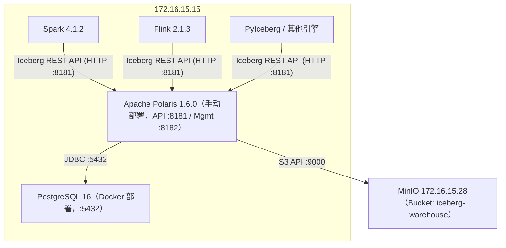

# Iceberg + MinIO + Apache Polaris 部署方案（v2）

> **版本**：v2.0  
> **日期**：2026-07-24  
> **目标机器**：172.16.15.15（Polaris / PostgreSQL / Spark / Flink）  
> **MinIO**：172.16.15.28:9000（已部署，bucket 已创建）

---

## 一、架构总览



---

## 二、环境信息汇总

| 组件             | 版本        | 部署位置                 | 说明                   |
| -------------- | --------- | -------------------- | -------------------- |
| Apache Polaris | 1.6.0     | 172.16.15.15（手动部署）   | Iceberg REST Catalog |
| PostgreSQL     | 16-alpine | 172.16.15.15（Docker） | Polaris 元数据持久化       |
| MinIO          | 已部署       | 172.16.15.28:9000    | S3 对象存储              |
| Spark          | 4.1.2     | 172.16.15.15         | 计算引擎                 |
| Flink          | 2.1.3     | 172.16.15.15         | 流计算引擎                |
| Iceberg        | 1.11.0    | —                    | 表格式                  |
| Java           | 21 (LTS)  | 172.16.15.15         | Polaris 运行时依赖        |

### MinIO 信息

| 项目         | 值                          |
| ---------- | -------------------------- |
| Endpoint   | `http://172.16.15.28:9000` |
| Console    | `http://172.16.15.28:9001` |
| Access Key | `admin`                    |
| Secret Key | `!Qivie20130113`           |
| Bucket     | `iceberg-warehouse`（已手动创建） |

---

## 三、PostgreSQL 部署（Docker）

### 3.1 创建数据目录

```bash
# 在 172.16.15.15 上执行
mkdir -p /wfy/postgresql/data
mkdir -p /wfy/postgresql/init
```

### 3.2 初始化 SQL

```bash
cat > /wfy/postgresql/init/01-init.sql << 'EOF'
-- 创建 Polaris 数据库和用户
CREATE DATABASE polaris;
CREATE USER polaris WITH PASSWORD 'PolarisPG@2026!Secure';
GRANT ALL PRIVILEGES ON DATABASE polaris TO polaris;

-- 切换到 polaris 数据库授权 schema
\c polaris
GRANT ALL ON SCHEMA public TO polaris;
ALTER DEFAULT PRIVILEGES IN SCHEMA public GRANT ALL ON TABLES TO polaris;
ALTER DEFAULT PRIVILEGES IN SCHEMA public GRANT ALL ON SEQUENCES TO polaris;
EOF
```

### 3.3 docker-compose.yml

```bash
cat > /wfy/postgresql/docker-compose.yml << 'EOF'
version: "3.9"

services:
  polaris-postgres:
    image: postgres:16-alpine
    container_name: polaris-postgres
    restart: always
    environment:
      POSTGRES_USER: postgres
      POSTGRES_PASSWORD: PostgresRoot@2026!
      POSTGRES_DB: postgres
    ports:
      - "5432:5432"
    volumes:
     var/lib/postgresql/data
      - ./init:/docker-entrypoint-initdb.d:ro
    healthcheck:
      test: ["CMD-SHELL", "pg_isready -U postgres"]
      interval: 5s
      timeout: 3s
      retries: 10
    deploy:
      resources:
        limits:
          cpus: "2.0"
          memory: 2G
        reservations:
          cpus: "0.5"
          memory: 512M
    logging:
      driver: json-file
      options:
        max-size: "50m"
        max-file: "3"
EOF
```

### 3.4 启动 PostgreSQL

```bash
cd /opt/polaris/postgresql
docker compose up -d

# 验证
docker exec polaris-postgres pg_isready -U postgres
# 预期输出: /var/run/postgresql:5432 - accepting connections

# 验证 polaris 数据库和用户
docker exec polaris-postgres psql -U postgres -c "\l" | grep polaris
docker exec polaris-postgres psql -U postgres -c "SELECT usename FROM pg_user WHERE usename='polaris';"
```

### 3.5 连接信息

| 项目       | 值                                             |
| -------- | --------------------------------------------- |
| Host     | `172.16.15.15`                                |
| Port     | `5432`                                        |
| Database | `polaris`                                     |
| User     | `polaris`                                     |
| Password | `PolarisPG@2026!Secure`                       |
| JDBC URL | `jdbc:postgresql://172.16.15.15:5432/polaris` |

---

## 四、Apache Polaris 部署（手动）

### 4.1 前置条件：安装 Java 21

Polaris 基于 Quarkus 构建，**必须使用 Java 21**。

```bash
# 检查当前 Java 版本
java -version

# 如果不是 Java 21，安装 OpenJDK 21
# CentOS / RHEL:
yum install -y java-21-openjdk java-21-openjdk-devel

# Ubuntu / Debian:
apt install -y openjdk-21-jdk

# 或手动下载:
cd /opt
wget https://download.java.net/java/GA/jdk21.0.2/f2283984656d49d69e91c558476027ac/13/GPL/openjdk-21.0.2_linux-x64_bin.tar.gz
tar -xzf openjdk-21.0.2_linux-x64_bin.tar.gz
ln -sf /opt/jdk-21.0.2 /opt/java21

# 设置 JAVA_HOME（Polaris 专用，不影响系统默认 Java）
export JAVA_HOME=/opt/java21
export PATH=$JAVA_HOME/bin:$PATH

# 验证
java -version
# 预期: openjdk version "21.0.x"
```

### 4.2 下载 Polaris 二进制包

```bash
# 创建安装目录
mkdir -p /opt/polaris/server
cd /opt/polaris/server

# 下载 Polaris 1.6.0 二进制包
wget https://dlcdn.apache.org/polaris/1.6.0/polaris-bin-1.6.0.tgz

# 校验完整性
wget https://dlcdn.apache.org/polaris/1.6.0/polaris-bin-1.6.0.tgz.sha512
sha512sum -c polaris-bin-1.6.0.tgz.sha512

# 解压
tar -xzf polaris-bin-1.6.0.tgz

# 查看目录结构
ls polaris-bin-1.6.0/
# 预期包含:
#   bin/          - 启动脚本
#   lib/          - 所有 JAR 依赖
#   config/       - 配置文件目录
#   quarkus-run.jar  - Quarkus 主入口
```

### 4.3 目录规划

```text
/opt/polaris/
├── postgresql/              # PostgreSQL Docker（第三章）
│   ├── docker-compose.yml
│   ├── data/
│   └── init/
├── server/                  # Polaris 二进制
│   └── polaris-bin-1.6.0/
│       ├── bin/
│       ├── lib/
│       ├── config/
│       └── quarkus-run.jar
├── config/                  # Polaris 自定义配置（覆盖默认）
│   └── application.properties
├── logs/                    # 日志目录
├── scripts/                 # 运维脚本
│   ├── start-polaris.sh
│   ├── stop-polaris.sh
│   └── bootstrap-catalog.sh
└── data/                    # Polaris 本地数据（如有）
```

```bash
mkdir -p /opt/polaris/{config,logs,scripts,data}
```

### 4.4 配置文件

```bash
cat > /opt/polaris/config/application.properties << 'EOF'
# ============================================================
# Apache Polaris 1.6.0 - 生产配置
# 部署位置: 172.16.15.15
# ============================================================

# ---------- 服务端口 ----------
quarkus.http.port=8181
quarkus.management.port=8182

# ---------- 持久化：PostgreSQL ----------
polaris.persistence.type=relational-jdbc
quarkus.datasource.jdbc.url=jdbc:postgresql://172.16.15.15:5432/polaris
quarkus.datasource.username=polaris
quarkus.datasource.password=PolarisPG@2026!Secure
quarkus.datasource.jdbc.max-size=20
quarkus.datasource.jdbc.min-size=5

# ---------- Realm 配置 ----------
polaris.realm-context.realms=POLARIS
polaris.realm-context.header-name=Polaris-Realm

# ---------- 认证模式 ----------
# internal: 使用 Polaris 内置 OAuth2（client_credentials）
polaris.authentication.mode=internal

# ---------- Feature Flags ----------
# 允许非 AWS S3 兼容存储（MinIO 必须开启）
polaris.features.ALLOW_INSECURE_STORAGE_TYPES=true
# 允许外部 catalog credential vending
polaris.features.ALLOW_EXTERNAL_CATALOG_CREDENTIAL_VENDING=true
# 允许覆盖表的 storage config
polaris.features.ALLOW_OVERLAPPING_CATALOG_URLS=true

# ---------- CORS（可选，按需开启） ----------
quarkus.http.cors=true
quarkus.http.cors.origins=/.*/
quarkus.http.cors.methods=GET,POST,PUT,DELETE,OPTIONS
quarkus.http.cors.headers=Authorization,Content-Type,Polaris-Realm,X-Iceberg-Access-Delegation

# ---------- 日志 ----------
quarkus.log.level=INFO
quarkus.log.category."org.apache.polaris".level=INFO
quarkus.log.file.enable=true
quarkus.log.file.path=/opt/polaris/logs/polaris.log
quarkus.log.file.rotation.max-file-size=100M
quarkus.log.file.rotation.max-backup-index=10

# ---------- 事件监听器线程池（1.6.0 新增） ----------
polaris.event-listener.executor.pool-size=4
polaris.event-listener.executor.queue-size=100
EOF
```

### 4.5 启动脚本

```bash
cat > /opt/polaris/scripts/start-polaris.sh << 'EOF'
#!/bin/bash
# ============================================================
# Apache Polaris 启动脚本
# ============================================================

POLARIS_HOME=/opt/polaris/server/polaris-bin-1.6.0
POLARIS_CONFIG=/opt/polaris/config
POLARIS_LOG=/opt/polaris/logs
JAVA_HOME=/opt/java21

export JAVA_HOME
export PATH=$JAVA_HOME/bin:$PATH

# JVM 参数
JAVA_OPTS="-Xms512m -Xmx2g -XX:+UseG1GC -XX:MaxGCPauseMillis=200"

echo "Starting Apache Polaris 1.6.0 ..."
echo "  JAVA_HOME: $JAVA_HOME"
echo "  Config:    $POLARIS_CONFIG/application.properties"
echo "  Log:       $POLARIS_LOG/polaris.log"

cd $POLARIS_HOME

nohup $JAVA_HOME/bin/java $JAVA_OPTS \
  -Dquarkus.config.locations=$POLARIS_CONFIG/application.properties \
  -jar quarkus-run.jar \
  > $POLARIS_LOG/polaris-stdout.log 2>&1 &

echo $! > /opt/polaris/polaris.pid
echo "Polaris started with PID: $(cat /opt/polaris/polaris.pid)"
echo "Waiting for startup..."

# 等待健康检查通过
for i in $(seq 1 30); do
  if curl -sf http://localhost:8182/q/health > /dev/null 2>&1; then
    echo "✓ Polaris is UP (http://172.16.15.15:8181)"
    exit 0
  fi
  sleep 2
done

echo "✗ Polaris failed to start within 60s. Check logs:"
echo "  tail -f $POLARIS_LOG/polaris.log"
exit 1
EOF

chmod +x /opt/polaris/scripts/start-polaris.sh
```

### 4.6 停止脚本

```bash
cat > /opt/polaris/scripts/stop-polaris.sh << 'EOF'
#!/bin/bash
PID_FILE=/opt/polaris/polaris.pid

if [ -f "$PID_FILE" ]; then
  PID=$(cat $PID_FILE)
  if kill -0 $PID 2>/dev/null; then
    echo "Stopping Polaris (PID: $PID)..."
    kill $PID
    # 等待优雅退出
    for i in $(seq 1 15); do
      if ! kill -0 $PID 2>/dev/null; then
        echo "✓ Polaris stopped."
        rm -f $PID_FILE
        exit 0
      fi
      sleep 1
    done
    # 强制终止
    echo "Force killing..."
    kill -9 $PID
    rm -f $PID_FILE
    echo "✓ Polaris killed."
  else
    echo "Process $PID not running."
    rm -f $PID_FILE
  fi
else
  echo "PID file not found. Polaris may not be running."
fi
EOF

chmod +x /opt/polaris/scripts/stop-polaris.sh
```

### 4.7 Systemd 服务（可选，推荐生产使用）

```bash
cat > /etc/systemd/system/polaris.service << 'EOF'
[Unit]
Description=Apache Polaris - Iceberg REST Catalog
After=network.target docker.service
Wants=network-online.target

[Service]
Type=simple
User=root
Environment="JAVA_HOME=/opt/java21"
Environment="PATH=/opt/java21/bin:/usr/local/bin:/usr/bin:/bin"
WorkingDirectory=/opt/polaris/server/polaris-bin-1.6.0
ExecStart=/opt/java21/bin/java -Xms512m -Xmx2g -XX:+UseG1GC \
  -Dquarkus.config.locations=/opt/polaris/config/application.properties \
  -jar quarkus-run.jar
ExecStop=/bin/kill -TERM $MAINPID
Restart=on-failure
RestartSec=10
StandardOutput=append:/opt/polaris/logs/polaris-stdout.log
StandardError=append:/opt/polaris/logs/polaris-stderr.log

[Install]
WantedBy=multi-user.target
EOF

systemctl daemon-reload
systemctl enable polaris
```

### 4.8 首次启动 & Bootstrap

```bash
# 方式一：使用启动脚本
/opt/polaris/scripts/start-polaris.sh

# 方式二：使用 systemd
systemctl start polaris
systemctl status polaris
```

启动成功后，执行 Bootstrap 初始化（创建 root 凭证）：

```bash
# Polaris Admin Tool Bootstrap
# 二进制包中自带 admin tool，位于 bin/ 目录
cd /opt/polaris/server/polaris-bin-1.6.0

# 初始化 realm 和 root 凭证
./bin/polaris-admin-tool bootstrap \
  --realm POLARIS \
  --root-credentials "root:PolarisRoot@2026!Change" \
  -Dquarkus.config.locations=/opt/polaris/config/application.properties

# 预期输出:
# Bootstrap completed successfully for realm: POLARIS
# Root principal credentials created.
```

> ⚠️ **重要**：`root:PolarisRoot@2026!Change` 是 root 凭证，仅用于管理操作。  
> 生产环境完成初始化后应轮换此凭证。

### 4.9 验证 Polaris 运行状态

```bash
# 健康检查
curl http://172.16.15.15:8182/q/health
# 预期: {"status":"UP","checks":[...]}

# REST API 配置端点
curl http://172.16.15.15:8181/api/catalog/v1/config
# 预期: 返回 JSON 配置

# 获取 OAuth2 Token（验证认证）
curl -s -X POST http://172.16.15.15:8181/api/catalog/v1/oauth/tokens \
  -d "grant_type=client_credentials" \
  -d "client_id=root" \
  -d "client_secret=PolarisRoot@2026!Change" \
  -d "scope=PRINCIPAL_ROLE:ALL" \
  -H "Polaris-Realm: POLARIS"
# 预期: {"access_token":"eyJ...","token_type":"bearer",...}
```

---

## 五、Polaris Catalog 初始化（创建 Catalog + 权限）

### 5.1 Bootstrap 脚本

```bash
cat > /opt/polaris/scripts/bootstrap-catalog.sh << 'SCRIPT'
#!/bin/bash
set -e

# ============================================================
# Polaris Catalog 初始化脚本
# 创建 Catalog、Principal、Role、Grant
# ============================================================

POLARIS_API="http://172.16.15.15:8181/api/catalog/v1"
POLARIS_MGMT="http://172.16.15.15:8181/api/management/v1"
REALM_HEADER="Polaris-Realm: POLARIS"

ROOT_CLIENT_ID="root"
ROOT_CLIENT_SECRET="PolarisRoot@2026!Change"

MINIO_ENDPOINT="http://172.16.15.28:9000"
MINIO_ACCESS_KEY="admin"
MINIO_SECRET_KEY="!Qivie20130113"
MINIO_BUCKET="iceberg-warehouse"

echo "=========================================="
echo " Polaris Catalog Bootstrap"
echo " MinIO: ${MINIO_ENDPOINT}"
echo " Bucket: ${MINIO_BUCKET}"
echo "=========================================="

# ---- Step 1: 获取 Root Token ----
echo ""
echo "[1/6] Obtaining root access token..."
TOKEN_RESPONSE=$(curl -s -X POST "${POLARIS_API}/oauth/tokens" \
  -d "grant_type=client_credentials" \
  -d "client_id=${ROOT_CLIENT_ID}" \
  -d "client_secret=${ROOT_CLIENT_SECRET}" \
  -d "scope=PRINCIPAL_ROLE:ALL" \
  -H "${REALM_HEADER}")

ACCESS_TOKEN=$(echo "$TOKEN_RESPONSE" | python3 -c "import sys,json; print(json.load(sys.stdin)['access_token'])" 2>/dev/null)

if [ -z "$ACCESS_TOKEN" ]; then
  echo "ERROR: Failed to obtain token."
  echo "Response: $TOKEN_RESPONSE"
  exit 1
fi
echo "  ✓ Token obtained"

AUTH_HEADER="Authorization: Bearer ${ACCESS_TOKEN}"

# ---- Step 2: 创建 Catalog ----
echo ""
echo "[2/6] Creating catalog 'iceberg_minio'..."
CATALOG_RESPONSE=$(curl -s -X POST "${POLARIS_MGMT}/catalogs" \
  -H "${AUTH_HEADER}" \
  -H "Content-Type: application/json" \
  -H "${REALM_HEADER}" \
  -d '{
    "catalog": {
      "name": "iceberg_minio",
      "type": "INTERNAL",
      "readOnly": false,
      "properties": {
        "default-base-location": "s3://'"${MINIO_BUCKET}"'/warehouse"
      },
      "storageConfigInfo": {
        "storageType": "S3",
        "allowedLocations": [
          "s3://'"${MINIO_BUCKET}"'/"
        ],
        "endpoint": "'"${MINIO_ENDPOINT}"'",
        "region": "us-east-1",
        "pathStyleAccess": true,
        "stsEnabled": false
      }
    }
  }')

echo "  Response: $CATALOG_RESPONSE"
echo "  ✓ Catalog 'iceberg_minio' created"

# ---- Step 3: 创建 Principal（引擎服务账号） ----
echo ""
echo "[3/6] Creating principal 'engine_svc'..."
PRINCIPAL_RESPONSE=$(curl -s -X POST "${POLARIS_MGMT}/principals" \
  -H "${AUTH_HEADER}" \
  -H "Content-Type: application/json" \
  -H "${REALM_HEADER}" \
  -d '{
    "principal": {
      "name": "engine_svc",
      "type": "SERVICE",
      "properties": {}
    }
  }')

CLIENT_ID=$(echo "$PRINCIPAL_RESPONSE" | python3 -c "import sys,json; print(json.load(sys.stdin)['credentials']['clientId'])" 2>/dev/null)
CLIENT_SECRET=$(echo "$PRINCIPAL_RESPONSE" | python3 -c "import sys,json; print(json.load(sys.stdin)['credentials']['clientSecret'])" 2>/dev/null)

if [ -z "$CLIENT_ID" ]; then
  echo "ERROR: Failed to create principal."
  echo "Response: $PRINCIPAL_RESPONSE"
  exit 1
fi

echo "  ✓ Principal created"
echo "    Client ID:     ${CLIENT_ID}"
echo "    Client Secret: ${CLIENT_SECRET}"

# ---- Step 4: 创建 Principal Role ----
echo ""
echo "[4/6] Creating principal role 'engine_role'..."
curl -s -X POST "${POLARIS_MGMT}/principal-roles" \
  -H "${AUTH_HEADER}" \
  -H "Content-Type: application/json" \
  -H "${REALM_HEADER}" \
  -d '{"principalRole": {"name": "engine_role"}}' > /dev/null

# 绑定 principal → principal role
curl -s -X PUT "${POLARIS_MGMT}/principals/engine_svc/principal-roles" \
  -H "${AUTH_HEADER}" \
  -H "Content-Type: application/json" \
  -H "${REALM_HEADER}" \
  -d '{"principalRole": {"name": "engine_role"}}' > /dev/null

echo "  ✓ Principal role created and bound"

# ---- Step 5: 创建 Catalog Role ----
echo ""
echo "[5/6] Creating catalog role 'admin_role'..."
curl -s -X POST "${POLARIS_MGMT}/catalogs/iceberg_minio/catalog-roles" \
  -H "${AUTH_HEADER}" \
  -H "Content-Type: application/json" \
  -H "${REALM_HEADER}" \
  -d '{"catalogRole": {"name": "admin_role"}}' > /dev/null

# 绑定 principal role → catalog role
curl -s -X PUT "${POLARIS_MGMT}/principal-roles/engine_role/catalog-roles/iceberg_minio" \
  -H "${AUTH_HEADER}" \
  -H "Content-Type: application/json" \
  -H "${REALM_HEADER}" \
  -d '{"catalogRole": {"name": "admin_role"}}' > /dev/null

echo "  ✓ Catalog role created and bound"

# ---- Step 6: 授权 ----
echo ""
echo "[6/6] Granting CATALOG_MANAGE_CONTENT to admin_role..."
curl -s -X PUT "${POLARIS_MGMT}/catalogs/iceberg_minio/catalog-roles/admin_role/grants" \
  -H "${AUTH_HEADER}" \
  -H "Content-Type: application/json" \
  -H "${REALM_HEADER}" \
  -d '{
    "grant": {
      "type": "catalog",
      "privilege": "CATALOG_MANAGE_CONTENT"
    }
  }' > /dev/null

echo "  ✓ Grant applied"

# ---- 输出结果 ----
echo ""
echo "=========================================="
echo " Bootstrap Complete!"
echo "=========================================="
echo ""
echo " Polaris REST API:  http://172.16.15.15:8181/api/catalog"
echo " Catalog Name:      iceberg_minio"
echo " Warehouse:         s3://${MINIO_BUCKET}/warehouse"
echo " MinIO Endpoint:    ${MINIO_ENDPOINT}"
echo ""
echo " ┌─────────────────────────────────────────┐"
echo " │  Engine Credentials (SAVE THESE!)       │"
echo " │                                         │"
echo " │  Client ID:     ${CLIENT_ID}"
echo " │  Client Secret: ${CLIENT_SECRET}"
echo " └─────────────────────────────────────────┘"
echo ""
echo " 将以上凭证填入 Spark / Flink 配置中。"
echo "=========================================="

# 保存凭证到文件（仅 root 可读）
cat > /opt/polaris/config/engine-credentials.env << CREDS
# Polaris Engine Credentials
# Generated: $(date '+%Y-%m-%d %H:%M:%S')
POLARIS_CLIENT_ID=${CLIENT_ID}
POLARIS_CLIENT_SECRET=${CLIENT_SECRET}
CREDS
chmod 600 /opt/polaris/config/engine-credentials.env
echo "Credentials saved to: /opt/polaris/config/engine-credentials.env"
SCRIPT

chmod +x /opt/polaris/scripts/bootstrap-catalog.sh
```

### 5.2 执行 Bootstrap

```bash
/opt/polaris/scripts/bootstrap-catalog.sh
```

**执行成功后，记录输出的 Client ID 和 Client Secret**，后续 Spark / Flink 配置需要使用。

---

## 六、Spark 4.1.2 配置

> Spark 部署在 172.16.15.15，与 Polaris 同机。

### 6.1 依赖 JAR

将以下 JAR 放入 `$SPARK_HOME/jars/` 目录：

```bash
cd $SPARK_HOME/jars/

# Iceberg Spark Runtime（Spark 4.x 对应 iceberg-spark-runtime-4.0）
wget https://repo1.maven.org/maven2/org/apache/iceberg/iceberg-spark-runtime-4.0_2.13/1.11.0/iceberg-spark-runtime-4.0_2.13-1.11.0.jar

# Iceberg AWS Bundle（S3FileIO 依赖）
wget https://repo1.maven.org/maven2/org/apache/iceberg/iceberg-aws-bundle/1.11.0/iceberg-aws-bundle-1.11.0.jar
```

### 6.2 spark-defaults.conf

编辑 `$SPARK_HOME/conf/spark-defaults.conf`：

```properties
# ============================================================
# Iceberg + Polaris REST Catalog 配置
# ============================================================

# Catalog 实现
spark.sql.catalog.polaris=org.apache.iceberg.spark.SparkCatalog
spark.sql.catalog.polaris.type=rest

# Polaris 连接
spark.sql.catalog.polaris.uri=http://172.16.15.15:8181/api/catalog
spark.sql.catalog.polaris.warehouse=iceberg_minio
spark.sql.catalog.polaris.header.Polaris-Realm=POLARIS

# OAuth2 认证（替换为 bootstrap 输出的实际值）
spark.sql.catalog.polaris.credential=<CLIENT_ID>:<CLIENT_SECRET>
spark.sql.catalog.polaris.scope=PRINCIPAL_ROLE:ALL
spark.sql.catalog.polaris.rest.auth.type=oauth2
spark.sql.catalog.polaris.oauth2-server-uri=http://172.16.15.15:8181/api/catalog/v1/oauth/tokens

# S3 / MinIO 配置（引擎直连模式）
spark.sql.catalog.polaris.io-impl=org.apache.iceberg.aws.s3.S3FileIO
spark.sql.catalog.polaris.s3.endpoint=http://172.16.15.28:9000
spark.sql.catalog.polaris.s3.path-style-access=true
spark.sql.catalog.polaris.s3.access-key-id=admin
spark.sql.catalog.polaris.s3.secret-access-key=!Qivie20130113

# Iceberg SQL 扩展
spark.sql.extensions=org.apache.iceberg.spark.extensions.IcebergSparkSessionExtensions
spark.sql.defaultCatalog=polaris
```

### 6.3 验证

```bash
# 启动 Spark SQL
$SPARK_HOME/bin/spark-sql --catalog polaris

# 在 Spark SQL 中执行：
```

```sql
-- 创建 namespace
CREATE NAMESPACE IF NOT EXISTS polaris.lakehouse;

-- 创建表
CREATE TABLE polaris.lakehouse.orders (
    order_id    BIGINT,
    customer_id BIGINT,
    amount      DECIMAL(10,2),
    order_time  TIMESTAMP
) USING iceberg
PARTITIONED BY (days(order_time));

-- 写入
INSERT INTO polaris.lakehouse.orders VALUES
(1, 1001, 99.99, current_timestamp()),
(2, 1002, 199.50, current_timestamp());

-- 查询
SELECT * FROM polaris.lakehouse.orders;

-- 查看表信息（确认 location 指向 MinIO）
DESCRIBE EXTENDED polaris.lakehouse.orders;
```

```bash
# 在 MinIO 上验证数据落盘
mc ls myminio/iceberg-warehouse/warehouse/lakehouse/orders/
# 预期看到: metadata/  data/
```

---

## 七、Flink 2.1.3 配置

> Flink 部署在 172.16.15.15，与 Polaris 同机。

### 7.1 依赖 JAR

将以下 JAR 放入 `$FLINK_HOME/lib/` 目录：

```bash
cd $FLINK_HOME/lib/

# Iceberg Flink Runtime
wget https://repo1.maven.org/maven2/org/apache/iceberg/iceberg-flink-runtime-2.1_2.12/1.11.0/iceberg-flink-runtime-2.1_2.12-1.11.0.jar

# Iceberg AWS Bundle（S3FileIO 依赖）
wget https://repo1.maven.org/maven2/org/apache/iceberg/iceberg-aws-bundle/1.11.0/iceberg-aws-bundle-1.11.0.jar
```

### 7.2 Flink SQL Client 注册 Catalog

启动 Flink SQL Client：

```bash
$FLINK_HOME/bin/sql-client.sh
```

在 SQL Client 中执行：

```sql
-- 注册 Polaris REST Catalog
CREATE CATALOG polaris_flink WITH (
  'type' = 'iceberg',
  'catalog-type' = 'rest',
  'uri' = 'http://172.16.15.15:8181/api/catalog',
  'warehouse' = 'iceberg_minio',
  'credential' = '<CLIENT_ID>:<CLIENT_SECRET>',
  'scope' = 'PRINCIPAL_ROLE:ALL',
  'header.Polaris-Realm' = 'POLARIS',
  'rest.auth.type' = 'oauth2',
  'oauth2-server-uri' = 'http://172.16.15.15:8181/api/catalog/v1/oauth/tokens',
  'io-impl' = 'org.apache.iceberg.aws.s3.S3FileIO',
  's3.endpoint' = 'http://172.16.15.28:9000',
  's3.path-style-access' = 'true',
  's3.access-key-id' = 'admin',
  's3.secret-access-key' = '!Qivie20130113'
);

-- 切换到 Polaris Catalog
USE CATALOG polaris_flink;

-- 创建 namespace
CREATE DATABASE IF NOT EXISTS lakehouse;

-- 创建表
CREATE TABLE lakehouse.events (
    event_id   BIGINT,
    event_type STRING,
    payload    STRING,
    event_time TIMESTAMP(3),
    WATERMARK FOR event_time AS event_time - INTERVAL '5' SECOND
) WITH (
    'format-version' = '2'
);

-- 写入
INSERT INTO lakehouse.events VALUES
(1, 'click', '{"page":"/home"}', TIMESTAMP '2026-07-24 10:00:00'),
(2, 'view', '{"page":"/product"}', TIMESTAMP '2026-07-24 10:01:00');

-- 查询
SELECT * FROM lakehouse.events;
```

### 7.3 跨引擎验证

```sql
-- 在 Flink 中查看 Spark 创建的表
USE CATALOG polaris_flink;
USE lakehouse;
SHOW TABLES;
-- 预期看到: orders, events

SELECT * FROM orders;
-- 预期看到 Spark 写入的 2 条数据
```

---

## 八、PyIceberg 配置（可选）

### 8.1 配置文件

```bash
mkdir -p ~/.pyiceberg
cat > ~/.pyiceberg/config.yaml << 'EOF'
catalog:
  polaris:
    type: rest
    uri: http://172.16.15.15:8181/api/catalog
    warehouse: iceberg_minio
    credential: "<CLIENT_ID>:<CLIENT_SECRET>"
    scope: "PRINCIPAL_ROLE:ALL"
    header:
      Polaris-Realm: POLARIS
    s3:
      endpoint: http://172.16.15.28:9000
      access-key-id: admin
      secret-access-key: "!Qivie20130113"
      path-style-access: "true"
EOF
```

### 8.2 使用示例

```python
from pyiceberg.catalog import load_catalog

catalog = load_catalog("polaris")

# 列出 namespaces
print(catalog.list_namespaces())

# 加载 Spark 创建的表
table = catalog.load_table("lakehouse.orders")
df = table.scan().to_pandas()
print(df)
```

---

## 九、验证清单

| # | 验证项 | 命令 | 预期结果 |
|---|--------|------|----------|
| 1 | PostgreSQL 运行 | `docker exec polaris-postgres pg_isready` | `accepting connections` |
| 2 | Polaris 健康检查 | `curl http://172.16.15.15:8182/q/health` | `{"status":"UP"}` |
| 3 | REST API 可达 | `curl http://172.16.15.15:8181/api/catalog/v1/config` | 返回 JSON |
| 4 | OAuth2 Token | `curl -X POST .../oauth/tokens -d "grant_type=client_credentials&..."` | 返回 `access_token` |
| 5 | Catalog 列表 | `curl -H "Authorization: Bearer ..." .../catalogs` | 包含 `iceberg_minio` |
| 6 | Spark 建表 | `CREATE TABLE polaris.lakehouse.test (id INT) USING iceberg` | 成功 |
| 7 | MinIO 数据落盘 | `mc ls myminio/iceberg-warehouse/warehouse/lakehouse/test/` | 有 `metadata/` `data/` |
| 8 | Flink 读写 | Flink SQL Client 中 INSERT + SELECT | 成功 |
| 9 | 跨引擎可见 | Spark 建的表在 Flink `SHOW TABLES` 中可见 | 一致 |
| 10 | PyIceberg 读取 | Python 脚本加载表并 `to_pandas()` | 返回 DataFrame |

---

## 十、运维管理

### 10.1 日常操作

```bash
# 启动 Polaris
/opt/polaris/scripts/start-polaris.sh
# 或
systemctl start polaris

# 停止 Polaris
/opt/polaris/scripts/stop-polaris.sh
# 或
systemctl stop polaris

# 查看日志
tail -f /opt/polaris/logs/polaris.log
tail -f /opt/polaris/logs/polaris-stdout.log

# 查看 PostgreSQL 日志
docker logs polaris-postgres --tail 100 -f

# 重启 PostgreSQL
cd /opt/polaris/postgresql && docker compose restart
```

### 10.2 监控接入

```yaml
# Prometheus scrape 配置
scrape_configs:
  - job_name: polaris
    metrics_path: /q/metrics
    static_configs:
      - targets: ['172.16.15.15:8182']
```

### 10.3 备份

```bash
# PostgreSQL 备份
docker exec polaris-postgres pg_dump -U polaris polaris > /opt/polaris/backup/polaris_$(date +%Y%m%d).sql

# 定时备份（crontab）
0 2 * * * docker exec polaris-postgres pg_dump -U polaris polaris | gzip > /opt/polaris/backup/polaris_$(date +\%Y\%m\%d).sql.gz
```

### 10.4 安全加固建议

| 项目 | 建议 |
|------|------|
| Polaris root 凭证 | Bootstrap 完成后通过 Management API 轮换 |
| MinIO 凭证 | 生产环境创建独立 service account，不使用 admin |
| 网络防火墙 | 8181/8182/5432 仅对计算引擎网段开放 |
| TLS | 生产环境为 Polaris 配置 HTTPS（Nginx 反代） |
| PostgreSQL | `pg_hba.conf` 限制来源 IP |
| 凭证文件 | `/opt/polaris/config/engine-credentials.env` 权限 600 |

---

## 十一、MinIO 注意事项

| 配置项 | 值 | 说明 |
|--------|-----|------|
| `pathStyleAccess` | `true` | MinIO **必须** path-style，否则 S3 SDK 解析 bucket 失败 |
| `stsEnabled` | `false` | MinIO 默认未启用 STS，引擎直连模式 |
| `region` | `us-east-1` | MinIO 不校验 region，但 S3 SDK 要求非空 |
| Bucket Versioning | 建议开启 | 防止 Iceberg metadata 文件误删 |

```bash
# 开启 bucket versioning（推荐）
mc version enable myminio/iceberg-warehouse
```

---

## 十二、故障排查

| 问题 | 可能原因 | 解决方法 |
|------|----------|----------|
| Polaris 启动失败 | Java 版本不是 21 | `java -version` 确认，设置 `JAVA_HOME` |
| Polaris 连不上 PG | JDBC URL 或密码错误 | 检查 `application.properties`，`psql` 手动连接测试 |
| Spark 报 `401 Unauthorized` | Client ID/Secret 错误 | 重新执行 bootstrap 或检查 `engine-credentials.env` |
| Spark 报 `AccessDenied` (S3) | MinIO 凭证或 endpoint 错误 | 检查 `s3.endpoint`、`s3.access-key-id`、`s3.secret-access-key` |
| 表创建成功但数据未落盘 | `path-style-access` 未开启 | 确认 `s3.path-style-access=true` |
| Flink 找不到 Iceberg 类 | JAR 未放入 `lib/` | 确认 `iceberg-flink-runtime` 和 `iceberg-aws-bundle` 在 `$FLINK_HOME/lib/` |
| 跨引擎表不可见 | warehouse 名称不一致 | Spark 和 Flink 的 `warehouse` 必须都是 `iceberg_minio` |
| Polaris 日志报 `realm not found` | 请求缺少 Realm Header | 确认所有请求带 `Polaris-Realm: POLARIS` |

---

## 附录 A：完整文件清单

```text
/opt/polaris/
├── postgresql/
│   ├── docker-compose.yml          # PostgreSQL Docker 编排
│   ├── data/                       # PG 数据卷
│   └── init/
│       └── 01-init.sql             # 初始化 SQL
├── server/
│   ├── polaris-bin-1.6.0.tgz      # 下载的二进制包
│   └── polaris-bin-1.6.0/         # 解压后的 Polaris
│       ├── bin/
│       ├── lib/
│       ├── config/
│       └── quarkus-run.jar
├── config/
│   ├── application.properties      # Polaris 主配置
│   └── engine-credentials.env      # 引擎凭证（bootstrap 生成）
├── logs/
│   ├── polaris.log                 # 应用日志
│   └── polaris-stdout.log          # 标准输出
├── scripts/
│   ├── start-polaris.sh            # 启动脚本
│   ├── stop-polaris.sh             # 停止脚本
│   └── bootstrap-catalog.sh        # Catalog 初始化脚本
├── backup/                         # 备份目录
└── polaris.pid                     # PID 文件
```

## 附录 B：端口清单

| 端口 | 服务 | 用途 |
|------|------|------|
| 8181 | Polaris | Iceberg REST API |
| 8182 | Polaris | Management / Health / Metrics |
| 5432 | PostgreSQL | 数据库连接 |
| 9000 | MinIO (172.16.15.28) | S3 API |
| 9001 | MinIO (172.16.15.28) | Web Console |
