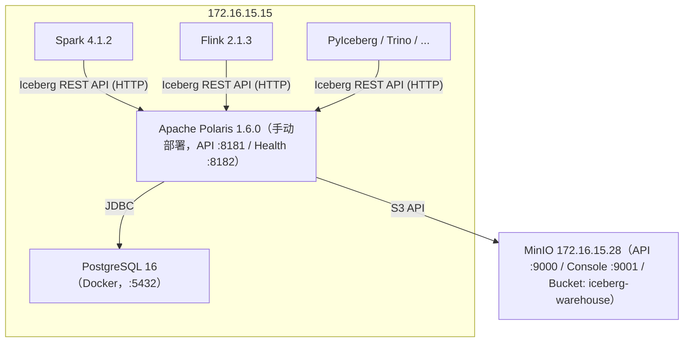
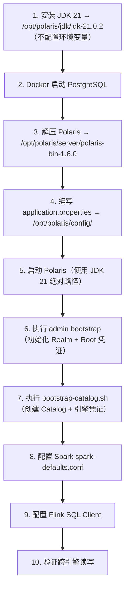

# Iceberg + MinIO + Apache Polaris 部署方案（v4）

> **版本**：v4.0
> **日期**：2026-07-25
> **部署机器**：172.16.15.15（Polaris / PostgreSQL / Spark / Flink）
> **存储**：MinIO 172.16.15.28:9000（Bucket 已创建）

---

## 一、架构总览



---

## 二、环境信息

| 组件 | 版本 | 部署方式 | 地址 |
|------|------|----------|------|
| Apache Polaris | 1.6.0 | 二进制包手动部署 | 172.16.15.15:8181 |
| PostgreSQL | 16-alpine | Docker | 172.16.15.15:5432 |
| MinIO | 已部署 | — | 172.16.15.28:9000 |
| Spark | 4.1.2 | 已有 | 172.16.15.15 |
| Flink | 2.1.3 | 已有 | 172.16.15.15 |
| Iceberg | 1.11.0 | — | — |
| JDK | 21 LTS | Polaris 专用（不配置环境变量） | 172.16.15.15 |

### MinIO 连接信息

| 项目 | 值 |
|------|-----|
| Endpoint | `http://172.16.15.28:9000` |
| Console | `http://172.16.15.28:9001` |
| Access Key | `admin` |
| Secret Key | `!Qivie20130113` |
| Bucket | `iceberg-warehouse`（已手动创建） |

---

## 三、PostgreSQL 部署（Docker）

### 3.1 目录准备

```bash
mkdir -p /opt/polaris/postgresql/{data,init}
```

### 3.2 初始化 SQL

```bash
cat > /opt/polaris/postgresql/init/01-init.sql << 'EOF'
CREATE DATABASE polaris;
CREATE USER polaris WITH PASSWORD 'PolarisPG@2026!Secure';
GRANT ALL PRIVILEGES ON DATABASE polaris TO polaris;
\c polaris
GRANT ALL ON SCHEMA public TO polaris;
ALTER DEFAULT PRIVILEGES IN SCHEMA public GRANT ALL ON TABLES TO polaris;
ALTER DEFAULT PRIVILEGES IN SCHEMA public GRANT ALL ON SEQUENCES TO polaris;
EOF
```

### 3.3 docker-compose.yml

```bash
cat > /opt/polaris/postgresql/docker-compose.yml << 'EOF'
version: "3.9"

services:
  polaris-postgres:
    image: postgres:16-alpine
    container_name: polaris-postgres
    restart: always
    environment:
      POSTGRES_USER: postgres
      POSTGRES_PASSWORD: PostgresRoot@2026!
    ports:
      - "5432:5432"
    volumes:
      - .//postgresql/data
      - ./init:/docker-entrypoint-initdb.d:ro
    healthcheck:
      test: ["CMD-SHELL", "pg_isready -U postgres"]
      interval: 5s
      timeout: 3s
      retries: 10
    deploy:
      resources:
        limits:
          cpus: "2.0"
          memory: 2G
    logging:
      driver: json-file
      options:
        max-size: "50m"
        max-file: "3"
EOF
```

### 3.4 启动与验证

```bash
cd /opt/polaris/postgresql
docker compose up -d

# 验证
docker exec polaris-postgres pg_isready -U postgres
# 预期: /var/run/postgresql:5432 - accepting connections

docker exec polaris-postgres psql -U postgres -c "\l" | grep polaris
docker exec polaris-postgres psql -U postgres -c "SELECT usename FROM pg_user WHERE usename='polaris';"
```

### 3.5 连接信息

| 项目 | 值 |
|------|-----|
| JDBC URL | `jdbc:postgresql://172.16.15.15:5432/polaris` |
| User | `polaris` |
| Password | `PolarisPG@2026!Secure` |

---

## 四、JDK 21 安装（Polaris 专用，不配置环境变量）

> ⚠️ **重要**：JDK 21 仅供 Polaris 使用，**不写入系统 `JAVA_HOME`、不修改 `PATH`**。
> Spark / Flink 继续使用系统原有的 Java 版本，互不影响。

### 4.1 下载并解压到 Polaris 专属目录

```bash
mkdir -p /opt/polaris/jdk
cd /opt/polaris/jdk

wget https://download.java.net/java/GA/jdk21.0.2/f2283984656d49d69e91c558476027ac/13/GPL/openjdk-21.0.2_linux-x64_bin.tar.gz
tar -xzf openjdk-21.0.2_linux-x64_bin.tar.gz
rm -f openjdk-21.0.2_linux-x64_bin.tar.gz
```

解压后路径为：`/opt/polaris/jdk/jdk-21.0.2`

### 4.2 验证（使用绝对路径）

```bash
/opt/polaris/jdk/jdk-21.0.2/bin/java -version
# 预期: openjdk version "21.0.2" 2024-01-16
```

### 4.3 确认系统 Java 未受影响

```bash
# 系统默认 Java 不变（Spark/Flink 使用）
java -version
# 预期: 你原来的版本（如 17.x 或 11.x）

echo $JAVA_HOME
# 预期: 你原来的值（或空）
```

> 后续所有 Polaris 相关脚本中，Java 均通过绝对路径
> `/opt/polaris/jdk/jdk-21.0.2/bin/java` 调用，不依赖任何环境变量。

---

## 五、Apache Polaris 部署（手动）

### 5.1 上传并解压二进制包

```bash
mkdir -p /opt/polaris/server
cd /opt/polaris/server

# 上传 polaris-bin-1.6.0.tgz 到此目录后解压
tar -xzf polaris-bin-1.6.0.tgz
```

### 5.2 实际目录结构

解压后 `/opt/polaris/server/polaris-bin-1.6.0/` 的结构如下：

```text
polaris-bin-1.6.0/
├── LICENSE
├── NOTICE
├── README.md
│
├── bin/                          ← 启动脚本
│   ├── server                    ← Polaris Server 启动脚本
│   └── admin                     ← Polaris Admin Tool 启动脚本
│
├── server/                       ← Polaris Server（主服务）
│   ├── quarkus-run.jar           ← 主入口 JAR
│   ├── app/
│   │   └── polaris-server-1.6.0.jar
│   ├── lib/
│   │   ├── boot/
│   │   │   └── io.quarkus.quarkus-bootstrap-runner-3.36.3.jar
│   │   └── main/
│   │       └── (依赖 JAR 包)
│   └── quarkus/
│       ├── generated-bytecode.jar
│       ├── quarkus-application.dat
│       └── transformed-bytecode.jar
│
└── admin/                        ← Polaris Admin Tool（管理工具）
    ├── quarkus-run.jar           ← Admin 入口 JAR
    ├── app/
    │   └── polaris-admin-1.6.0.jar
    ├── lib/
    │   ├── boot/
    │   │   └── io.quarkus.quarkus-bootstrap-runner-3.36.3.jar
    │   └── main/
    │       └── (依赖 JAR 包)
    └── quarkus/
        ├── generated-bytecode.jar
        ├── quarkus-application.dat
        └── transformed-bytecode.jar
```

### 5.3 创建配置与运维目录

```bash
mkdir -p /opt/polaris/{config,logs,scripts,backup}
```

最终完整目录规划：

```text
/opt/polaris/
├── jdk/
│   └── jdk-21.0.2/              # JDK 21（Polaris 专用）
├── server/
│   └── polaris-bin-1.6.0/       # Polaris 二进制（解压后）
│       ├── bin/
│       ├── server/
│       └── admin/
├── postgresql/                   # PostgreSQL Docker（第三章）
│   ├── docker-compose.yml
│   ├── data/
│   └── init/
├── config/                       # Polaris 自定义配置
│   └── application.properties
├── logs/                         # 日志
├── scripts/                      # 运维脚本
│   ├── start-polaris.sh
│   ├── stop-polaris.sh
│   └── bootstrap-catalog.sh
├── backup/                       # 备份
└── polaris.pid                   # PID 文件
```

### 5.4 配置文件

```bash
cat > /data/polaris-1.6.0/config/application.properties << 'EOF'
# ============================================================
# Apache Polaris 1.6.0 配置
# 部署: 172.16.15.15
# ============================================================

# ---------- 端口 ----------
quarkus.http.port=8181
quarkus.management.port=8182

# ---------- 持久化: PostgreSQL ----------
polaris.persistence.type=relational-jdbc
quarkus.datasource.jdbc.url=jdbc:postgresql://172.16.15.15:5432/polaris
quarkus.datasource.username=polaris
quarkus.datasource.password=PolarisPG@2026!Secure
quarkus.datasource.jdbc.max-size=20
quarkus.datasource.jdbc.min-size=5

# ---------- Realm ----------
polaris.realm-context.realms=POLARIS
polaris.realm-context.header-name=Polaris-Realm

# ---------- 认证: 内置 OAuth2 ----------
polaris.authentication.mode=internal

# ---------- Feature Flags ----------
# MinIO 必须: 允许非 AWS S3 兼容存储
polaris.features.ALLOW_INSECURE_STORAGE_TYPES=true
polaris.features.ALLOW_EXTERNAL_CATALOG_CREDENTIAL_VENDING=true
polaris.features.ALLOW_OVERLAPPING_CATALOG_URLS=true

# ---------- CORS ----------
quarkus.http.cors=true
quarkus.http.cors.origins=/.*/
quarkus.http.cors.methods=GET,POST,PUT,DELETE,OPTIONS
quarkus.http.cors.headers=Authorization,Content-Type,Polaris-Realm,X-Iceberg-Access-Delegation

# ---------- 日志 ----------
quarkus.log.level=INFO
quarkus.log.category."org.apache.polaris".level=INFO
quarkus.log.file.enable=true
quarkus.log.file.path=/opt/polaris/logs/polaris.log
quarkus.log.file.rotation.max-file-size=100M
quarkus.log.file.rotation.max-backup-index=10

# ---------- 事件监听器线程池 (1.6.0 新增) ----------
polaris.event-listener.executor.pool-size=4
polaris.event-listener.executor.queue-size=100
EOF
```

### 5.5 启动脚本

> 使用 JDK 21 绝对路径，不依赖系统 `JAVA_HOME` 或 `PATH`。

```bash
cat > /data/polaris-1.6.0/scripts/start-polaris.sh << 'EOF'
#!/bin/bash
# ============================================================
# Apache Polaris 启动脚本
# JDK 21 通过绝对路径指定，不影响系统环境变量
# ============================================================

# JDK 21 绝对路径（Polaris 专用）
JAVA=/opt/polaris/jdk/jdk-21.0.2/bin/java

# Polaris 路径
POLARIS_HOME=/opt/polaris/server/polaris-bin-1.6.0
POLARIS_CONFIG=/opt/polaris/config/application.properties
POLARIS_LOG=/opt/polaris/logs

# JVM 参数
JAVA_OPTS="-Xms512m -Xmx2g -XX:+UseG1GC -XX:MaxGCPauseMillis=200"

echo "Starting Apache Polaris 1.6.0 ..."
echo "  Java:    $JAVA"
echo "  Config:  $POLARIS_CONFIG"
echo "  Log:     $POLARIS_LOG/polaris.log"

# 检查 Java 版本
$JAVA -version 2>&1 | head -1

cd $POLARIS_HOME/server

nohup $JAVA $JAVA_OPTS \
  -Dquarkus.config.locations=$POLARIS_CONFIG \
  -jar quarkus-run.jar \
  > $POLARIS_LOG/polaris-stdout.log 2>&1 &

echo $! > /opt/polaris/polaris.pid
echo "PID: $(cat /opt/polaris/polaris.pid)"

# 等待启动（最多 60 秒）
for i in $(seq 1 30); do
  if curl -sf http://localhost:8182/q/health > /dev/null 2>&1; then
    echo "✓ Polaris is UP → http://172.16.15.15:8181"
    exit 0
  fi
  sleep 2
done

echo "✗ 启动超时，请检查日志:"
echo "  tail -f $POLARIS_LOG/polaris.log"
echo "  tail -f $POLARIS_LOG/polaris-stdout.log"
exit 1
EOF
chmod +x /data/polaris-1.6.0/scripts/start-polaris.sh
```

### 5.6 停止脚本

```bash
cat > /data/polaris-1.6.0/scripts/stop-polaris.sh << 'EOF'
#!/bin/bash
PID_FILE=/opt/polaris/polaris.pid

if [ -f "$PID_FILE" ]; then
  PID=$(cat $PID_FILE)
  if kill -0 $PID 2>/dev/null; then
    echo "Stopping Polaris (PID: $PID)..."
    kill $PID
    for i in $(seq 1 15); do
      if ! kill -0 $PID 2>/dev/null; then
        echo "✓ Polaris stopped."
        rm -f $PID_FILE
        exit 0
      fi
      sleep 1
    done
    kill -9 $PID
    rm -f $PID_FILE
    echo "✓ Polaris force killed."
  else
    echo "Process $PID not running."
    rm -f $PID_FILE
  fi
else
  echo "PID file not found. Polaris may not be running."
fi
EOF
chmod +x /data/polaris-1.6.0/scripts/stop-polaris.sh
```

### 5.7 Systemd 服务（推荐生产使用）

> 同样使用 JDK 21 绝对路径，不设置 `Environment="JAVA_HOME=..."`。

```bash
cat > /etc/systemd/system/polaris.service << 'EOF'
[Unit]
Description=Apache Polaris - Iceberg REST Catalog
After=network.target docker.service
Wants=network-online.target

[Service]
Type=simple
User=root
WorkingDirectory=/opt/polaris/server/polaris-bin-1.6.0/server
ExecStart=/opt/polaris/jdk/jdk-21.0.2/bin/java \
  -Xms512m -Xmx2g -XX:+UseG1GC \
  -Dquarkus.config.locations=/opt/polaris/config/application.properties \
  -jar quarkus-run.jar
Restart=on-failure
RestartSec=10
StandardOutput=append:/opt/polaris/logs/polaris-stdout.log
StandardError=append:/opt/polaris/logs/polaris-stderr.log

[Install]
WantedBy=multi-user.target
EOF

systemctl daemon-reload
systemctl enable polaris
```

### 5.8 首次启动

```bash
# 方式一：启动脚本
/opt/polaris/scripts/start-polaris.sh

# 方式二：systemd
systemctl start polaris
systemctl status polaris
```

### 5.9 Bootstrap（初始化 Realm 和 Root 凭证）

使用 `admin/quarkus-run.jar` 执行初始化：

```bash
/opt/polaris/jdk/jdk-21.0.2/bin/java \
  -Dquarkus.config.locations=/opt/polaris/config/application.properties \
  -jar /opt/polaris/server/polaris-bin-1.6.0/admin/quarkus-run.jar \
  bootstrap \
  --realm POLARIS \
  --root-credentials "root:PolarisRoot@2026!Change"
```

预期输出：
```text
Bootstrap completed successfully for realm: POLARIS
```

### 5.10 验证 Polaris 运行状态

```bash
# 健康检查
curl http://172.16.15.15:8182/q/health
# 预期: {"status":"UP","checks":[...]}

# REST API 配置端点
curl http://172.16.15.15:8181/api/catalog/v1/config
# 预期: 返回 JSON

# 获取 OAuth2 Token
curl -s -X POST http://172.16.15.15:8181/api/catalog/v1/oauth/tokens \
  -d "grant_type=client_credentials" \
  -d "client_id=root" \
  -d "client_secret=PolarisRoot@2026!Change" \
  -d "scope=PRINCIPAL_ROLE:ALL" \
  -H "Polaris-Realm: POLARIS"
# 预期: {"access_token":"eyJ...","token_type":"bearer",...}
```

---

## 六、Catalog 初始化（创建 Catalog / 权限 / 引擎凭证）

### 6.1 Bootstrap 脚本

```bash
cat > /opt/polaris/scripts/bootstrap-catalog.sh << 'SCRIPT'
#!/bin/bash
set -e

POLARIS_API="http://172.16.15.15:8181/api/catalog/v1"
POLARIS_MGMT="http://172.16.15.15:8181/api/management/v1"
REALM="Polaris-Realm: POLARIS"

ROOT_ID="root"
ROOT_SECRET="PolarisRoot@2026!Change"

MINIO_ENDPOINT="http://172.16.15.28:9000"
MINIO_BUCKET="iceberg-warehouse"

echo "=========================================="
echo " Polaris Catalog Bootstrap"
echo " MinIO: ${MINIO_ENDPOINT}"
echo " Bucket: ${MINIO_BUCKET}"
echo "=========================================="

# ---- 1. 获取 Root Token ----
echo ""
echo "[1/6] 获取 Root Token..."
TOKEN_RESP=$(curl -s -X POST "${POLARIS_API}/oauth/tokens" \
  -d "grant_type=client_credentials" \
  -d "client_id=${ROOT_ID}" \
  -d "client_secret=${ROOT_SECRET}" \
  -d "scope=PRINCIPAL_ROLE:ALL" \
  -H "${REALM}")

TOKEN=$(echo "$TOKEN_RESP" | python3 -c "import sys,json;print(json.load(sys.stdin)['access_token'])" 2>/dev/null)
if [ -z "$TOKEN" ]; then
  echo "ERROR: 获取 Token 失败"
  echo "Response: $TOKEN_RESP"
  exit 1
fi
AUTH="Authorization: Bearer ${TOKEN}"
echo "  ✓ OK"

# ---- 2. 创建 Catalog（指向 MinIO） ----
echo ""
echo "[2/6] 创建 Catalog 'iceberg_minio'..."
curl -s -X POST "${POLARIS_MGMT}/catalogs" \
  -H "$AUTH" -H "Content-Type: application/json" -H "${REALM}" \
  -d '{
    "catalog": {
      "name": "iceberg_minio",
      "type": "INTERNAL",
      "readOnly": false,
      "properties": {
        "default-base-location": "s3://'"${MINIO_BUCKET}"'/warehouse"
      },
      "storageConfigInfo": {
        "storageType": "S3",
        "allowedLocations": ["s3://'"${MINIO_BUCKET}"'/"],
        "endpoint": "'"${MINIO_ENDPOINT}"'",
        "region": "us-east-1",
        "pathStyleAccess": true,
        "stsEnabled": false
      }
    }
  }' > /dev/null
echo "  ✓ OK"

# ---- 3. 创建 Principal（引擎服务账号） ----
echo ""
echo "[3/6] 创建 Principal 'engine_svc'..."
PRIN_RESP=$(curl -s -X POST "${POLARIS_MGMT}/principals" \
  -H "$AUTH" -H "Content-Type: application/json" -H "${REALM}" \
  -d '{"principal":{"name":"engine_svc","type":"SERVICE","properties":{}}}')

CLIENT_ID=$(echo "$PRIN_RESP" | python3 -c "import sys,json;print(json.load(sys.stdin)['credentials']['clientId'])" 2>/dev/null)
CLIENT_SECRET=$(echo "$PRIN_RESP" | python3 -c "import sys,json;print(json.load(sys.stdin)['credentials']['clientSecret'])" 2>/dev/null)

if [ -z "$CLIENT_ID" ]; then
  echo "ERROR: 创建 Principal 失败"
  echo "Response: $PRIN_RESP"
  exit 1
fi
echo "  ✓ Client ID:     ${CLIENT_ID}"
echo "    Client Secret: ${CLIENT_SECRET}"

# ---- 4. 创建 Principal Role 并绑定 ----
echo ""
echo "[4/6] 创建 Principal Role 'engine_role'..."
curl -s -X POST "${POLARIS_MGMT}/principal-roles" \
  -H "$AUTH" -H "Content-Type: application/json" -H "${REALM}" \
  -d '{"principalRole":{"name":"engine_role"}}' > /dev/null

curl -s -X PUT "${POLARIS_MGMT}/principals/engine_svc/principal-roles" \
  -H "$AUTH" -H "Content-Type: application/json" -H "${REALM}" \
  -d '{"principalRole":{"name":"engine_role"}}' > /dev/null
echo "  ✓ OK"

# ---- 5. 创建 Catalog Role 并绑定 ----
echo ""
echo "[5/6] 创建 Catalog Role 'admin_role'..."
curl -s -X POST "${POLARIS_MGMT}/catalogs/iceberg_minio/catalog-roles" \
  -H "$AUTH" -H "Content-Type: application/json" -H "${REALM}" \
  -d '{"catalogRole":{"name":"admin_role"}}' > /dev/null

curl -s -X PUT "${POLARIS_MGMT}/principal-roles/engine_role/catalog-roles/iceberg_minio" \
  -H "$AUTH" -H "Content-Type: application/json" -H "${REALM}" \
  -d '{"catalogRole":{"name":"admin_role"}}' > /dev/null
echo "  ✓ OK"

# ---- 6. 授权 ----
echo ""
echo "[6/6] 授予 CATALOG_MANAGE_CONTENT..."
curl -s -X PUT "${POLARIS_MGMT}/catalogs/iceberg_minio/catalog-roles/admin_role/grants" \
  -H "$AUTH" -H "Content-Type: application/json" -H "${REALM}" \
  -d '{"grant":{"type":"catalog","privilege":"CATALOG_MANAGE_CONTENT"}}' > /dev/null
echo "  ✓ OK"

# ---- 输出结果 ----
echo ""
echo "=========================================="
echo " ✓ Bootstrap 完成"
echo "=========================================="
echo ""
echo " REST API:   http://172.16.15.15:8181/api/catalog"
echo " Catalog:    iceberg_minio"
echo " Warehouse:  s3://${MINIO_BUCKET}/warehouse"
echo ""
echo " ┌───────────────────────────────────────────────────┐"
echo " │  引擎凭证（请保存！Spark / Flink 配置需要）         │"
echo " │                                                   │"
echo " │  Client ID:     ${CLIENT_ID}"
echo " │  Client Secret: ${CLIENT_SECRET}"
echo " └───────────────────────────────────────────────────┘"

# 保存凭证到文件
cat > /opt/polaris/config/engine-credentials.env << CREDS
# Polaris Engine Credentials
# Generated: $(date '+%Y-%m-%d %H:%M:%S')
POLARIS_CLIENT_ID=${CLIENT_ID}
POLARIS_CLIENT_SECRET=${CLIENT_SECRET}
CREDS
chmod 600 /opt/polaris/config/engine-credentials.env
echo ""
echo " 凭证已保存: /opt/polaris/config/engine-credentials.env"
SCRIPT

chmod +x /opt/polaris/scripts/bootstrap-catalog.sh
```

### 6.2 执行

```bash
/opt/polaris/scripts/bootstrap-catalog.sh
```

> ⚠️ **执行后务必记录输出的 Client ID 和 Client Secret**，后续 Spark / Flink 配置需要。

---

## 七、Spark 4.1.2 配置

> Spark 部署在 172.16.15.15，与 Polaris 同机。

### 7.1 依赖 JAR

```bash
cd $SPARK_HOME/jars/

# Iceberg Spark Runtime (Spark 4.x → iceberg-spark-runtime-4.0)
wget https://repo1.maven.org/maven2/org/apache/iceberg/iceberg-spark-runtime-4.0_2.13/1.11.0/iceberg-spark-runtime-4.0_2.13-1.11.0.jar

# Iceberg AWS Bundle (S3FileIO)
wget https://repo1.maven.org/maven2/org/apache/iceberg/iceberg-aws-bundle/1.11.0/iceberg-aws-bundle-1.11.0.jar
```

### 7.2 spark-defaults.conf

编辑 `$SPARK_HOME/conf/spark-defaults.conf`，追加：

```properties
# ===== Iceberg + Polaris REST Catalog =====
spark.sql.catalog.polaris=org.apache.iceberg.spark.SparkCatalog
spark.sql.catalog.polaris.type=rest
spark.sql.catalog.polaris.uri=http://172.16.15.15:8181/api/catalog
spark.sql.catalog.polaris.warehouse=iceberg_minio
spark.sql.catalog.polaris.header.Polaris-Realm=POLARIS

# OAuth2 认证（替换为 bootstrap 输出的实际值）
spark.sql.catalog.polaris.credential=<CLIENT_ID>:<CLIENT_SECRET>
spark.sql.catalog.polaris.scope=PRINCIPAL_ROLE:ALL
spark.sql.catalog.polaris.rest.auth.type=oauth2
spark.sql.catalog.polaris.oauth2-server-uri=http://172.16.15.15:8181/api/catalog/v1/oauth/tokens

# MinIO S3 配置
spark.sql.catalog.polaris.io-impl=org.apache.iceberg.aws.s3.S3FileIO
spark.sql.catalog.polaris.s3.endpoint=http://172.16.15.28:9000
spark.sql.catalog.polaris.s3.path-style-access=true
spark.sql.catalog.polaris.s3.access-key-id=admin
spark.sql.catalog.polaris.s3.secret-access-key=!Qivie20130113

# Iceberg 扩展
spark.sql.extensions=org.apache.iceberg.spark.extensions.IcebergSparkSessionExtensions
spark.sql.defaultCatalog=polaris
```

### 7.3 验证

```bash
$SPARK_HOME/bin/spark-sql --catalog polaris
```

```sql
CREATE NAMESPACE IF NOT EXISTS polaris.lakehouse;

CREATE TABLE polaris.lakehouse.orders (
    order_id    BIGINT,
    customer_id BIGINT,
    amount      DECIMAL(10,2),
    order_time  TIMESTAMP
) USING iceberg
PARTITIONED BY (days(order_time));

INSERT INTO polaris.lakehouse.orders VALUES
(1, 1001, 99.99, current_timestamp()),
(2, 1002, 199.50, current_timestamp());

SELECT * FROM polaris.lakehouse.orders;

-- 确认 location 指向 MinIO
DESCRIBE EXTENDED polaris.lakehouse.orders;
```

---

## 八、Flink 2.1.3 配置

> Flink 部署在 172.16.15.15，与 Polaris 同机。

### 8.1 依赖 JAR

```bash
cd $FLINK_HOME/lib/

# Iceberg Flink Runtime
wget https://repo1.maven.org/maven2/org/apache/iceberg/iceberg-flink-runtime-2.1_2.12/1.11.0/iceberg-flink-runtime-2.1_2.12-1.11.0.jar

# Iceberg AWS Bundle (S3FileIO)
wget https://repo1.maven.org/maven2/org/apache/iceberg/iceberg-aws-bundle/1.11.0/iceberg-aws-bundle-1.11.0.jar
```

### 8.2 Flink SQL Client

```bash
$FLINK_HOME/bin/sql-client.sh
```

```sql
-- 注册 Polaris Catalog
CREATE CATALOG polaris_flink WITH (
  'type' = 'iceberg',
  'catalog-type' = 'rest',
  'uri' = 'http://172.16.15.15:8181/api/catalog',
  'warehouse' = 'iceberg_minio',
  'credential' = '<CLIENT_ID>:<CLIENT_SECRET>',
  'scope' = 'PRINCIPAL_ROLE:ALL',
  'header.Polaris-Realm' = 'POLARIS',
  'rest.auth.type' = 'oauth2',
  'oauth2-server-uri' = 'http://172.16.15.15:8181/api/catalog/v1/oauth/tokens',
  'io-impl' = 'org.apache.iceberg.aws.s3.S3FileIO',
  's3.endpoint' = 'http://172.16.15.28:9000',
  's3.path-style-access' = 'true',
  's3.access-key-id' = 'admin',
  's3.secret-access-key' = '!Qivie20130113'
);

USE CATALOG polaris_flink;
CREATE DATABASE IF NOT EXISTS lakehouse;

-- 创建流表
CREATE TABLE lakehouse.events (
    event_id   BIGINT,
    event_type STRING,
    payload    STRING,
    event_time TIMESTAMP(3),
    WATERMARK FOR event_time AS event_time - INTERVAL '5' SECOND
) WITH ('format-version' = '2');

-- 写入
INSERT INTO lakehouse.events VALUES
(1, 'click', '{"page":"/home"}', TIMESTAMP '2026-07-25 10:00:00');

-- 查询
SELECT * FROM lakehouse.events;

-- 跨引擎验证：读取 Spark 创建的表
SELECT * FROM lakehouse.orders;
```

---

## 九、PyIceberg 配置（可选）

```bash
mkdir -p ~/.pyiceberg
cat > ~/.pyiceberg/config.yaml << 'EOF'
catalog:
  polaris:
    type: rest
    uri: http://172.16.15.15:8181/api/catalog
    warehouse: iceberg_minio
    credential: "<CLIENT_ID>:<CLIENT_SECRET>"
    scope: "PRINCIPAL_ROLE:ALL"
    header:
      Polaris-Realm: POLARIS
    s3:
      endpoint: http://172.16.15.28:9000
      access-key-id: admin
      secret-access-key: "!Qivie20130113"
      path-style-access: "true"
EOF
```

```python
from pyiceberg.catalog import load_catalog

catalog = load_catalog("polaris")
print(catalog.list_namespaces())

table = catalog.load_table("lakehouse.orders")
print(table.scan().to_pandas())
```

---

## 十、验证清单

| # | 验证项 | 命令 | 预期 |
|---|--------|------|------|
| 1 | PostgreSQL | `docker exec polaris-postgres pg_isready` | `accepting connections` |
| 2 | Polaris 健康 | `curl http://172.16.15.15:8182/q/health` | `{"status":"UP"}` |
| 3 | REST API | `curl http://172.16.15.15:8181/api/catalog/v1/config` | JSON |
| 4 | OAuth2 | `curl -X POST .../oauth/tokens ...` | `access_token` |
| 5 | Spark 建表 | `CREATE TABLE polaris.lakehouse.test ...` | 成功 |
| 6 | MinIO 落盘 | `mc ls myminio/iceberg-warehouse/warehouse/lakehouse/test/` | `metadata/` `data/` |
| 7 | Flink 读写 | SQL Client INSERT + SELECT | 成功 |
| 8 | 跨引擎 | Spark 表在 Flink `SHOW TABLES` 可见 | 一致 |

---

## 十一、运维管理

### 日常操作

```bash
# 启动 / 停止 Polaris
/opt/polaris/scripts/start-polaris.sh
/opt/polaris/scripts/stop-polaris.sh
# 或
systemctl start polaris
systemctl stop polaris

# 查看日志
tail -f /opt/polaris/logs/polaris.log
tail -f /opt/polaris/logs/polaris-stdout.log

# PostgreSQL
cd /opt/polaris/postgresql && docker compose restart
docker logs polaris-postgres --tail 50

# 备份
docker exec polaris-postgres pg_dump -U polaris polaris \
  > /opt/polaris/backup/polaris_$(date +%Y%m%d).sql
```

### 监控

```yaml
# Prometheus scrape 配置
scrape_configs:
  - job_name: polaris
    metrics_path: /q/metrics
    static_configs:
      - targets: ['172.16.15.15:8182']
```

### 安全加固

| 项目 | 建议 |
|------|------|
| Root 凭证 | Bootstrap 后通过 Management API 轮换 |
| MinIO 凭证 | 生产环境创建独立 service account，不使用 admin |
| 防火墙 | 8181/8182/5432 仅对计算网段开放 |
| TLS | Nginx 反代 Polaris 加 HTTPS |
| 凭证文件 | `engine-credentials.env` 权限 600 |

---

## 十二、MinIO 注意事项

| 配置 | 值 | 说明 |
|------|-----|------|
| `pathStyleAccess` | `true` | MinIO **必须**，否则 bucket 解析失败 |
| `stsEnabled` | `false` | MinIO 默认无 STS，引擎直连 |
| `region` | `us-east-1` | MinIO 不校验，S3 SDK 要求非空 |

```bash
# 建议开启 bucket versioning 防误删
mc alias set myminio http://172.16.15.28:9000 admin '!Qivie20130113'
mc version enable myminio/iceberg-warehouse
```

---

## 十三、故障排查

| 问题 | 原因 | 解决 |
|------|------|------|
| Polaris 启动失败 | Java 版本 ≠ 21 | `/opt/polaris/jdk/jdk-21.0.2/bin/java -version` 确认 |
| 连不上 PostgreSQL | JDBC URL / 密码错误 | `psql -h 172.16.15.15 -U polaris -d polaris` 测试 |
| Spark 401 | Client ID/Secret 错误 | 检查 `/opt/polaris/config/engine-credentials.env` |
| S3 AccessDenied | MinIO 凭证 / endpoint 错误 | 检查 `s3.endpoint`、AK/SK |
| 数据未落盘 | `path-style-access` 未开 | 确认 `=true` |
| Flink 找不到类 | JAR 未放入 `lib/` | 确认两个 JAR 在 `$FLINK_HOME/lib/` |
| 跨引擎不可见 | warehouse 名不一致 | 统一为 `iceberg_minio` |
| `realm not found` | 缺少 Header | 所有请求带 `Polaris-Realm: POLARIS` |

---

## 附录 A：完整目录结构

```text
/opt/polaris/
├── jdk/
│   └── jdk-21.0.2/                  # JDK 21（Polaris 专用，不配置环境变量）
│       └── bin/java                 # 绝对路径调用
├── server/
│   └── polaris-bin-1.6.0/           # Polaris 二进制
│       ├── bin/
│       │   ├── server               # Server 启动脚本（自带）
│       │   └── admin                # Admin 启动脚本（自带）
│       ├── server/                  # Server 主服务
│       │   ├── quarkus-run.jar      # ← 主入口
│       │   ├── app/
│       │   ├── lib/
│       │   └── quarkus/
│       └── admin/                   # Admin Tool
│           ├── quarkus-run.jar      # ← Admin 入口
│           ├── app/
│           ├── lib/
│           └── quarkus/
├── postgresql/                       # PostgreSQL Docker
│   ├── docker-compose.yml
│   ├── data/
│   └── init/
│       └── 01-init.sql
├── config/
│   ├── application.properties        # Polaris 主配置
│   └── engine-credentials.env        # 引擎凭证（bootstrap 生成）
├── logs/
│   ├── polaris.log                   # 应用日志
│   ├── polaris-stdout.log            # 标准输出
│   └── polaris-stderr.log            # 标准错误
├── scripts/
│   ├── start-polaris.sh
│   ├── stop-polaris.sh
│   └── bootstrap-catalog.sh
├── backup/
└── polaris.pid
```

## 附录 B：端口清单

| 端口 | 服务 | 机器 |
|------|------|------|
| 8181 | Polaris REST API | 172.16.15.15 |
| 8182 | Polaris Health / Metrics | 172.16.15.15 |
| 5432 | PostgreSQL | 172.16.15.15 |
| 9000 | MinIO S3 API | 172.16.15.28 |
| 9001 | MinIO Console | 172.16.15.28 |

## 附录 C：部署顺序速查


