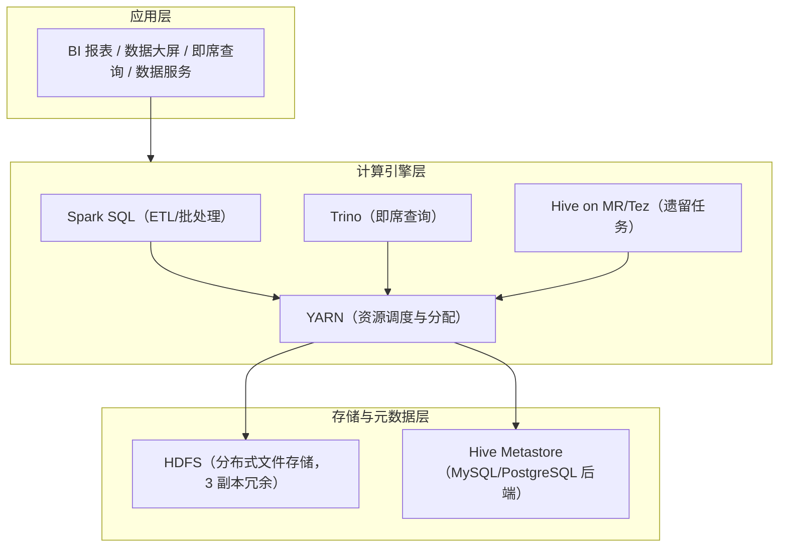
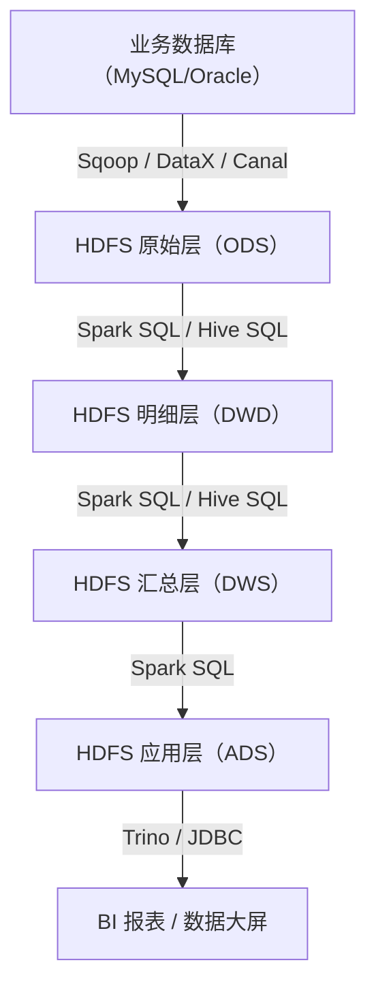
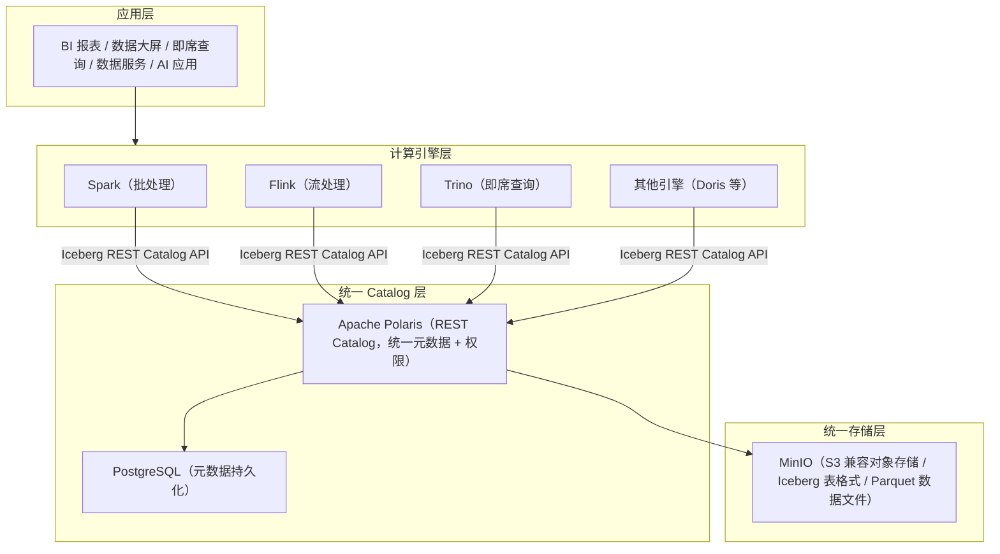
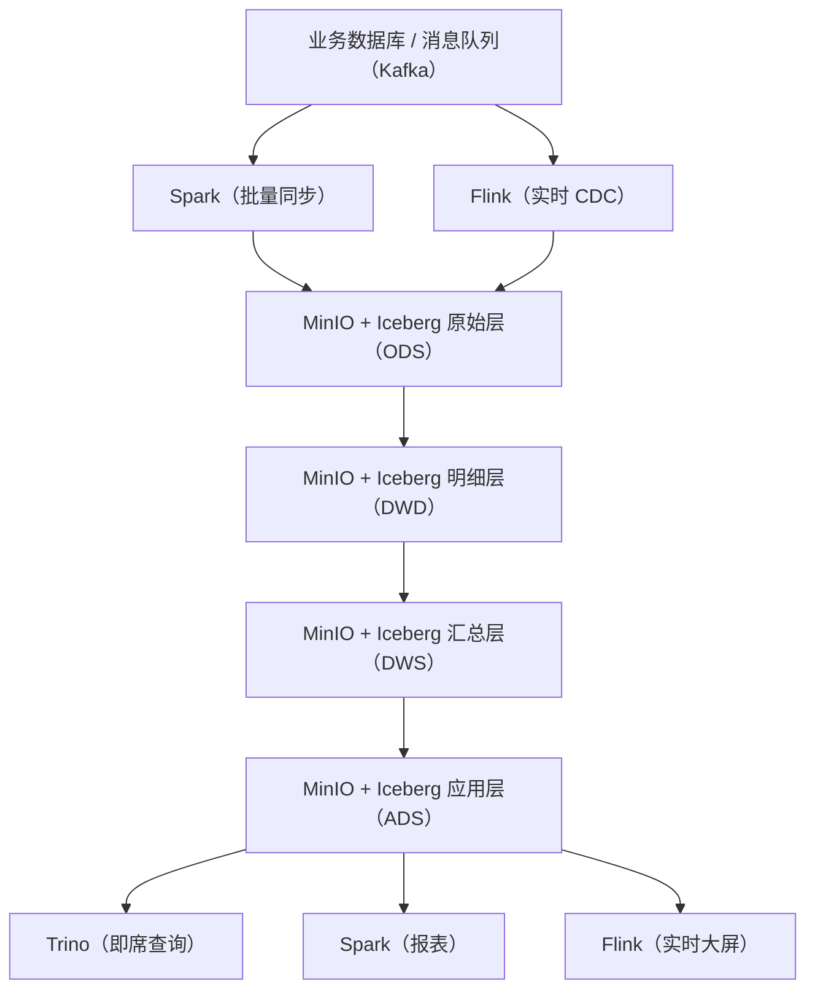
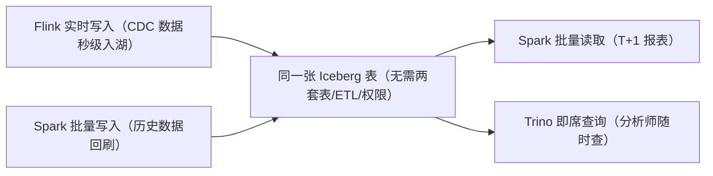
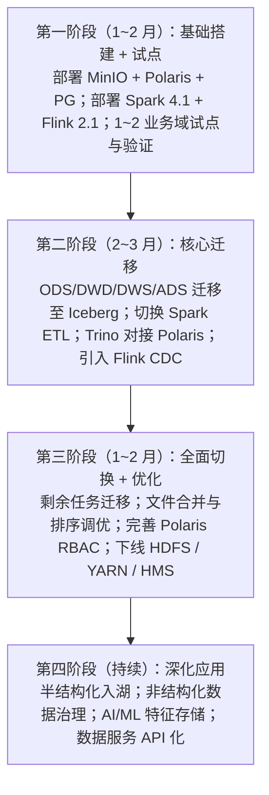

# 从离线数仓到湖仓一体：架构改造方案说明

> 版本：V1.0
> 日期：2026-07-27
> 状态：方案论证阶段

---

## 一、现有离线数仓架构

### 1.1 架构总览



### 1.2 各组件职责

| 组件                 | 职责                                       | 版本现状       |
| ------------------ | ---------------------------------------- | ---------- |
| **HDFS**           | 分布式文件存储，数据以 3 副本方式落盘                     | Hadoop 3.x |
| **YARN**           | 集群资源调度，为 Spark/Hive/MapReduce 分配 CPU 和内存 | Hadoop 3.x |
| **Hive Metastore** | 管理库、表、分区、Schema 等元数据                     | Hive 3.x   |
| **Hive on MR/Tez** | 遗留的 SQL 查询和 ETL 任务                       | 逐步淘汰中      |
| **Spark SQL**      | 主力 ETL 引擎，T+1 批处理                        | Spark 3.x  |
| **Trino**          | 即席查询（Ad-hoc），面向分析师                       | -          |

### 1.3 典型数据流



**核心特征：全链路 T+1，数据以 Hive 表（Parquet/ORC）形式存储在 HDFS 上。**

---

## 二、目标湖仓一体架构

### 2.1 架构总览



### 2.2 各组件职责

| 组件 | 职责 | 替代原有 |
|------|------|----------|
| **MinIO** | S3 兼容对象存储，存放 Iceberg 数据文件 | 替代 HDFS |
| **Apache Iceberg** | 开放表格式，ACID 事务、Schema 演进、时间旅行 | 替代 Hive 表格式 |
| **Apache Polaris** | Iceberg REST Catalog，统一元数据与权限管理 | 替代 Hive Metastore |
| **PostgreSQL** | Polaris 元数据持久化后端 | 替代 HMS 的 MySQL |
| **Spark 4.1** | 批处理 ETL（无 Hadoop 依赖） | 升级 Spark 3.x |
| **Flink 2.1** | 实时/准实时流处理（新增能力） | 无（原架构不具备） |
| **Trino** | 即席查询（通过 REST Catalog 对接） | 保留，改对接方式 |

### 2.3 目标数据流



**核心变化：批流一体，ODS 层即可被实时写入，下游分钟级可见。**

---

## 三、现有架构痛点与湖仓一体优化

### 3.1 痛点全景

| # | 痛点 | 影响 | 严重程度 |
|---|------|------|----------|
| 1 | 存算耦合，扩容必须同时扩存储和计算 | 资源浪费，成本高 | 🔴 高 |
| 2 | HDFS 3 副本，存储利用率仅 33% | 硬件成本翻倍 | 🔴 高 |
| 3 | T+1 时效，无法支撑实时业务 | 业务决策滞后 | 🔴 高 |
| 4 | Hive Metastore 单点，多引擎对接复杂 | 运维负担重 | 🟡 中 |
| 5 | 无 ACID 事务，并发写入数据不一致 | 数据质量风险 | 🔴 高 |
| 6 | Schema 变更困难（ALTER TABLE 锁表） | 迭代速度慢 | 🟡 中 |
| 7 | YARN 调度粒度粗，资源争抢严重 | 任务排队，SLA 不达标 | 🟡 中 |
| 8 | 小文件问题（HDFS NameNode 压力） | 集群性能退化 | 🟡 中 |
| 9 | 引擎间数据孤岛，权限各自为政 | 安全合规风险 | 🟡 中 |
| 10 | Hadoop 生态老化，社区活跃度下降 | 长期技术风险 | 🟡 中 |

### 3.2 逐项对比

#### 痛点 1：存算耦合

|         | 现有架构（HDFS + YARN）         | 湖仓一体（MinIO + 独立引擎）              |
| ------- | ------------------------- | ------------------------------- |
| **现状**  | DataNode 既存数据又跑计算，扩容必须加整机 | -                               |
| **问题**  | 存储不够时被迫连计算一起扩，反之亦然        | -                               |
| **改造后** | -                         | MinIO 独立扩容存储；Spark/Flink 独立扩容计算 |
| **收益**  | -                         | 存储和计算按需弹性伸缩，资源利用率提升 40%+        |

#### 痛点 2：存储成本

| | 现有架构 | 湖仓一体 |
|---|---|---|
| **冗余策略** | HDFS 3 副本（1TB 数据占 3TB 磁盘） | MinIO 纠删码（EC:4 仅需 1.33x 冗余） |
| **1PB 实际占用** | ~3PB | ~1.33PB |
| **硬件成本** | 基准 | 降低约 55% |
| **附加** | HDFS NameNode 内存随文件数线性增长 | MinIO 无此瓶颈，元数据轻量 |

#### 痛点 3：T+1 时效

| | 现有架构 | 湖仓一体 |
|---|---|---|
| **数据时效** | T+1（隔天可见） | 分钟级（Flink CDC 实时入湖） |
| **链路** | Sqoop 全量/增量 → HDFS → Spark 批处理 | Kafka/CDC → Flink → Iceberg 表（实时 commit） |
| **查询可见性** | 次日凌晨跑批后可查 | Flink checkpoint 完成后即可查（秒~分钟级） |
| **批流统一** | 批和流是两套系统、两套代码 | 同一张 Iceberg 表，Spark 批读 + Flink 流写 |

#### 痛点 4：元数据管理

| | 现有架构（Hive Metastore） | 湖仓一体（Polaris） |
|---|---|---|
| **协议** | Thrift（私有协议） | Iceberg REST（开放标准） |
| **引擎对接** | 每个引擎需单独配置 HMS 地址、兼容版本 | 统一 REST API，任何兼容引擎即插即用 |
| **多引擎共享** | Spark 用 HMS，Trino 用 HMS Connector，配置各异 | 所有引擎指向同一个 Polaris URL |
| **权限** | HMS 无内置权限，依赖 Ranger/Sentry | Polaris 内置 RBAC，精确到表/列级别 |
| **凭证管理** | 每个引擎配置 HDFS/S3 AK/SK | Polaris Credential Vending，临时凭证下发 |
| **高可用** | HMS 需额外做 HA（多实例 + ZooKeeper） | Polaris 无状态，多实例 + 负载均衡即可 |

#### 痛点 5：ACID 事务

| | 现有架构（Hive 表） | 湖仓一体（Iceberg 表） |
|---|---|---|
| **事务支持** | Hive ACID（ORC + 事务表），限制多、性能差 | Iceberg 原生 ACID，乐观并发控制 |
| **并发写入** | 需加锁，写冲突频繁失败 | 多引擎并发写入，自动冲突检测与重试 |
| **读写隔离** | 写入过程中读取可能看到脏数据 | 快照隔离，写入不影响读取 |
| **原子性** | 多步操作非原子（INSERT OVERWRITE 中途失败留残留） | 每次 commit 原子生效，失败自动回滚 |

#### 痛点 6：Schema 演进

| | 现有架构 | 湖仓一体 |
|---|---|---|
| **加列** | `ALTER TABLE ADD COLUMNS`，需重写元数据，大表可能锁表 | Iceberg 元数据级操作，毫秒完成，不触碰数据文件 |
| **改列类型** | 受限（如 INT→BIGINT 需重建表） | 支持安全的类型提升（INT→BIGINT→DECIMAL） |
| **删列/重命名** | 不支持或需重建 | 原生支持，基于列 ID 而非列名 |
| **历史数据** | 旧分区 Schema 不一致时查询报错 | 自动适配，旧文件用旧 Schema 读，新文件用新 Schema |

#### 痛点 7：资源调度

| | 现有架构（YARN） | 湖仓一体 |
|---|---|---|
| **调度模型** | 集中式，所有任务排队等 YARN 分配 Container | 去中心化，Spark/Flink 独立部署 |
| **资源争抢** | Hive 大查询占满队列，Spark ETL 被阻塞 | 各引擎独立资源池，互不干扰 |
| **弹性** | 扩缩容需加/减 NodeManager 节点 | Spark on K8s / Flink on K8s，Pod 级弹性 |
| **轻量任务** | 启动一个 YARN Container 需 10~30 秒 | Spark local 模式 / Flink Session 模式，秒级启动 |

#### 痛点 8：小文件问题

| | 现有架构（HDFS） | 湖仓一体（Iceberg + MinIO） |
|---|---|---|
| **影响** | NameNode 内存爆炸（每文件 ~150B 元数据），集群退化 | MinIO 无 NameNode 瓶颈 |
| **治理** | 需定期跑 merge 任务，额外资源消耗 | Iceberg 内置 `rewrite_data_files` 自动合并 |
| **流式写入** | Flink 写 HDFS 产生海量小文件 | Iceberg 按 checkpoint 粒度 commit，天然控制文件大小 |

#### 痛点 9：数据孤岛与权限

| | 现有架构 | 湖仓一体 |
|---|---|---|
| **元数据** | Spark 看 HMS，Trino 看 HMS Connector，各自缓存 | 所有引擎通过 Polaris 看到同一份元数据 |
| **权限** | HDFS ACL + Hive 授权 + Ranger 策略，三套体系 | Polaris RBAC 统一管控 |
| **审计** | 分散在各引擎日志中 | Polaris 统一审计日志 |
| **新增引擎** | 需重新配置 HMS、HDFS、权限 | 指向 Polaris URL 即可，权限自动继承 |

#### 痛点 10：技术生态

| | 现有架构 | 湖仓一体 |
|---|---|---|
| **社区趋势** | Hadoop 生态进入维护期，Cloudera 合并后创新放缓 | Iceberg 是 Apache 顶级项目，Snowflake/Databricks/Apple/Netflix 共同推动 |
| **人才** | Hadoop 运维人才逐渐稀缺 | 云原生 + 对象存储是行业主流方向 |
| **兼容性** | 绑定 HDFS 协议 | S3 协议是事实标准，可无缝迁移到 AWS S3 / 阿里云 OSS |

---

## 四、湖仓一体的其他优势

### 4.1 时间旅行（Time Travel）

Iceberg 表保留完整的快照历史：

```sql
-- 查询昨天凌晨的数据状态
SELECT * FROM db1.orders VERSION AS OF 12345;

-- 查询某个时间点的数据
SELECT * FROM db1.orders TIMESTAMP AS OF '2026-07-26 02:00:00';

-- 误删数据后回滚
CALL polaris.system.rollback_to_snapshot('db1.orders', 12345);
```

**应用场景：** 数据审计、误操作恢复、A/B 对比分析、数据血缘追溯。

### 4.2 隐藏分区（Hidden Partitioning）

```sql
-- 传统 Hive：用户必须知道分区字段
SELECT * FROM logs WHERE dt = '2026-07-27' AND hour = '10';

-- Iceberg：自动分区转换，用户写自然条件
SELECT * FROM logs WHERE event_time > '2026-07-27 10:00:00';
-- Iceberg 自动将 event_time 映射到 day(event_time) 分区，无需用户感知
```

### 4.3 分区演进（Partition Evolution）

```sql
-- 初期按天分区
ALTER TABLE db1.orders SET PARTITION FIELD (day(order_time));

-- 业务量增长后改为按小时分区（无需重建表、无需迁移数据）
ALTER TABLE db1.orders ADD PARTITION FIELD (hour(order_time));
ALTER TABLE db1.orders DROP PARTITION FIELD (day(order_time));
-- 旧数据仍按天分区读取，新数据按小时分区写入，查询自动适配
```

### 4.4 开放格式，无厂商锁定

| 维度 | 说明 |
|------|------|
| 表格式 | Apache Iceberg 是开放标准，非任何厂商私有 |
| 存储 | S3 协议是行业标准，MinIO / AWS S3 / 阿里云 OSS / 华为 OBS 通用 |
| Catalog | Iceberg REST 是开放协议，Polaris / Nessie / Tabular / Unity 均兼容 |
| 引擎 | Spark / Flink / Trino / Doris / StarRocks / Dremio / Presto 均原生支持 |
| **退出成本** | 任何时候可以换引擎、换存储、换 Catalog，数据无需迁移 |

### 4.5 统一批流



### 4.6 数据安全

| 能力 | 说明 |
|------|------|
| Credential Vending | 客户端不存储 S3 AK/SK，Polaris 下发临时凭证 |
| 细粒度 RBAC | 精确到 Catalog / Namespace / Table 级别的读写权限 |
| 审计追踪 | 所有操作通过 Polaris 统一记录 |
| 传输加密 | MinIO 支持 TLS，Polaris 支持 HTTPS |
| 静态加密 | MinIO 支持 SSE-S3 / SSE-KMS 服务端加密 |

---

## 五、半结构化与非结构化数据处理

### 5.1 现有架构的局限

| 数据类型 | 现有处理方式 | 问题 |
|----------|-------------|------|
| JSON 日志 | 存入 HDFS 文本文件，Hive 用 `get_json_object()` 解析 | 无 Schema，查询慢，无法列裁剪 |
| 嵌套 JSON | 多层 `get_json_object()` 嵌套，SQL 极其复杂 | 可维护性差 |
| 图片/音视频 | 存 HDFS 小文件 或 外部 NAS | 与数仓割裂，无法关联分析 |
| PDF/文档 | 不在数仓范围内 | 数据孤岛 |
| 物联网时序 | 单独部署时序数据库 | 多套系统，运维成本高 |

### 5.2 湖仓一体的处理能力

#### 半结构化数据（JSON / 嵌套结构）

**Iceberg V3 + Variant 类型（Iceberg 1.11.0 支持）：**

```sql
-- 创建包含 Variant 列的表（半结构化数据原生存储）
CREATE TABLE db1.app_logs (
    log_id      BIGINT,
    event_time  TIMESTAMP,
    user_id     STRING,
    payload     VARIANT          -- JSON 数据直接存入 Variant 列
) USING iceberg;

-- 写入 JSON 数据
INSERT INTO db1.app_logs VALUES (
    1,
    current_timestamp(),
    'user_001',
    PARSE_JSON('{"action":"click","page":"/home","duration_ms":1200,"nested":{"os":"iOS","ver":"17.0"}}')
);

-- 查询嵌套字段（无需 get_json_object）
SELECT
    log_id,
    payload:action::STRING        AS action,
    payload:nested:os::STRING     AS os,
    payload:duration_ms::INT      AS duration
FROM db1.app_logs
WHERE payload:action::STRING = 'click';
```

**优势对比：**

| | Hive（现有） | Iceberg Variant（湖仓） |
|---|---|---|
| 存储 | 整行 JSON 字符串，无法列裁剪 | Variant 二进制编码，支持列级裁剪 |
| 查询 | `get_json_object(payload, '$.nested.os')` | `payload:nested:os::STRING` |
| 性能 | 全行扫描 + 字符串解析 | 二进制直接定位，性能提升 5~10x |
| Schema | 无 Schema，字段拼写错误运行时才发现 | 可混合使用固定列 + Variant 灵活列 |
| 演进 | 新增字段需改 ETL 代码 | 新字段自动包含在 Variant 中，无需改表 |

**Flink 实时 JSON 入湖：**

```sql
-- Flink SQL：Kafka JSON → Iceberg 表
CREATE TABLE kafka_logs (
    log_id    BIGINT,
    payload   STRING
) WITH (
    'connector' = 'kafka',
    'topic'     = 'app-logs',
    'format'    = 'json'
);

INSERT INTO polaris.db1.app_logs
SELECT
    log_id,
    CURRENT_TIMESTAMP,
    NULL,
    CAST(payload AS VARIANT)
FROM kafka_logs;
```

#### 非结构化数据（图片 / 音视频 / 文档）

**MinIO 作为统一对象存储：**

```text
MinIO
├── iceberg-warehouse/          ← Iceberg 表数据（结构化 + 半结构化）
│   ├── db1/
│   └── db2/
├── raw-files/                  ← 非结构化原始文件
│   ├── images/2026-07-27/
│   ├── documents/contracts/
│   └── audio/call-records/
└── ml-features/                ← AI/ML 特征数据
    ├── embeddings/
    └── training-sets/
```

**结构化元数据 + 非结构化文件关联：**

```sql
-- Iceberg 表存储文件元数据，MinIO 存储文件本体
CREATE TABLE db1.document_registry (
    doc_id       BIGINT,
    doc_name     STRING,
    doc_type     STRING,           -- 'pdf', 'image', 'audio'
    file_path    STRING,           -- 's3://raw-files/documents/contract_001.pdf'
    file_size    BIGINT,
    upload_time  TIMESTAMP,
    ocr_text     STRING,           -- OCR 提取的文本（可选）
    embedding    ARRAY<FLOAT>,     -- 向量化表示（用于 AI 检索）
    tags         VARIANT           -- 灵活标签 {"department":"法务","status":"已审核"}
) USING iceberg
PARTITIONED BY (doc_type, days(upload_time));
```

**与 AI/ML 工作流集成：**

```python
# PyIceberg + MinIO：读取图片元数据 → 下载图片 → 模型推理
from pyiceberg.catalog.rest import RestCatalog
import boto3

catalog = RestCatalog(
    name="polaris",
    uri="http://polaris:8181/api/catalog",
    warehouse="minio_catalog",
    credential="root:admin123456",
)

# 读取 Iceberg 表中的文件注册信息
table = catalog.load_table("db1.document_registry")
df = table.scan(
    row_filter="doc_type = 'image'",
    selected_fields=("doc_id", "file_path", "embedding"),
).to_pandas()

# 通过 MinIO 下载实际文件
s3 = boto3.client('s3', endpoint_url='http://172.16.15.28:9000')
for _, row in df.iterrows():
    s3.download_file('raw-files', row['file_path'], f"/tmp/{row['doc_id']}.jpg")
```

### 5.3 数据类型支持矩阵

| 数据类型 | 现有架构 | 湖仓一体 | 提升 |
|----------|----------|----------|------|
| 结构化（行列） | ✅ Hive 表 | ✅ Iceberg 表 + ACID | 事务、Schema 演进 |
| 半结构化（JSON） | ⚠️ 文本存储 + UDF 解析 | ✅ Variant 原生类型 | 性能 5~10x，SQL 简洁 |
| 时序数据 | ❌ 需外部时序库 | ✅ Iceberg 表 + 分区演进 | 统一存储，减少系统数 |
| 图片/音视频 | ❌ HDFS 小文件 / 外部 NAS | ✅ MinIO 对象存储 + 元数据表 | 统一管理，可关联查询 |
| 文档/PDF | ❌ 不在数仓范围 | ✅ MinIO + OCR + 向量化 | 纳入数据治理体系 |
| AI 特征/向量 | ❌ 独立特征平台 | ✅ Iceberg 表（ARRAY<FLOAT>） | 特征与业务数据同库 |

---

## 六、对计算引擎性能与资源的影响

### 6.1 总体影响评估

| 维度 | 影响方向 | 说明 |
|------|----------|------|
| 存储 I/O | ⬇️ 略有变化 | 网络存储 vs 本地磁盘，延迟增加但吞吐可通过并行弥补 |
| 查询性能 | ⬆️ 提升 | Iceberg 统计信息 + 列裁剪 + 谓词下推更优 |
| 资源占用 | ⬇️ 降低 | 去除 YARN / HDFS Client / HMS Client 开销 |
| 弹性伸缩 | ⬆️ 大幅提升 | 存算分离后计算资源可独立扩缩 |
| 运维复杂度 | ⬇️ 降低 | 不再维护 HDFS / YARN / ZooKeeper / HMS |

### 6.2 Spark 性能影响

#### 读取性能

| 场景 | HDFS + Hive 表 | MinIO + Iceberg 表 | 差异 |
|------|---------------|-------------------|------|
| 全表扫描 | 本地磁盘读取，延迟 ~1ms | 网络读取，延迟 ~5ms | MinIO 略慢 |
| 全表扫描（吞吐） | 受限于单机磁盘带宽 | 多节点并行拉取，聚合带宽更高 | Iceberg 持平或更优 |
| 分区裁剪 | Hive 分区（目录级） | Iceberg 隐藏分区（元数据级） | Iceberg 更精准 |
| 列裁剪 | Parquet/ORC 列裁剪 | Parquet 列裁剪 + Iceberg 列统计 | 持平 |
| 谓词下推 | Parquet min/max | Iceberg 文件级 + 行组级 min/max + 分区统计 | Iceberg 更优（多一层文件级过滤） |
| 小文件读取 | HDFS 小文件 → NameNode 瓶颈 | MinIO 无此问题 + Iceberg 自动合并 | Iceberg 显著更优 |

#### 写入性能

| 场景 | HDFS + Hive | MinIO + Iceberg | 差异 |
|------|------------|-----------------|------|
| 批量写入 | 3 副本写入（写放大 3x） | MinIO 纠删码（写放大 ~1.33x） | Iceberg 写入更快 |
| 并发写入 | 需加锁，冲突失败 | 乐观并发，自动重试 | Iceberg 更优 |
| 流式写入 | 不支持（HDFS 不擅长） | Flink + Iceberg 原生支持 | 新增能力 |

#### 资源占用变化

```text
现有 Spark on YARN 资源开销：
├── YARN ResourceManager        ~2GB（集群级）
├── YARN NodeManager            ~1GB × N 节点
├── HDFS DataNode               ~4GB × N 节点
├── HDFS NameNode               ~8GB+（随文件数增长）
├── ZooKeeper                   ~1GB × 3 节点
├── Hive Metastore              ~2GB × 2 节点
└── Spark Executor              实际计算资源

湖仓一体资源开销：
├── MinIO                       ~2GB × N 节点（轻量）
├── PostgreSQL                  ~2GB（已有实例复用）
├── Polaris Server              ~2GB × 1~2 实例
└── Spark Executor              实际计算资源（相同）

节省：YARN + HDFS + ZooKeeper + HMS 的固定开销（约 20~50GB 集群级）
```

### 6.3 Flink 性能影响（新增引擎）

| 维度 | 说明 |
|------|------|
| 部署模式 | Flink Session / Application on K8s，无需 YARN |
| Checkpoint | 基于 Iceberg commit，每 10s~60s 一次，数据分钟级可见 |
| 资源 | 每个 Flink 作业独立 TaskManager，资源隔离 |
| 与 Spark 互不影响 | Flink 流式写入不占用 Spark 批处理资源 |
| 小文件控制 | Iceberg 按 checkpoint 粒度生成文件，天然避免小文件 |

### 6.4 Trino 性能影响

| 场景 | 现有（Hive Connector） | 改造后（Iceberg REST Connector） |
|------|----------------------|-------------------------------|
| 元数据获取 | 通过 HMS Thrift，有缓存延迟 | 通过 Polaris REST，实时一致 |
| 查询规划 | HMS 分区信息 + HDFS 文件列表 | Iceberg 元数据（manifest 文件），更快 |
| 文件裁剪 | 分区级 | 分区 + 文件级 + 行组级（三层过滤） |
| 并发查询 | 共享 HMS 连接池，高并发时瓶颈 | Polaris 无状态，水平扩展 |
| 缓存 | Trino 自带元数据缓存 | 可配合 Iceberg 元数据缓存进一步优化 |

### 6.5 网络带宽考量

存算分离后，计算节点通过网络访问 MinIO，需要关注：

| 项目 | 建议 |
|------|------|
| 网络带宽 | 计算节点与 MinIO 之间 ≥ 10Gbps 网络 |
| 部署拓扑 | MinIO 与计算节点同机房 / 同机架，降低延迟 |
| 并行度 | Iceberg 读取天然并行（多文件多连接），可充分利用带宽 |
| 缓存 | 热数据可启用 Spark 本地缓存（`spark.sql.catalog.polaris.cache-enabled=true`） |
| 监控 | 关注 MinIO 的 API 请求延迟和吞吐量指标 |

### 6.6 性能优化建议

| 优化项 | 配置 | 效果 |
|--------|------|------|
| Iceberg 文件合并 | `CALL system.rewrite_data_files(table => 'db1.t1')` | 减少小文件，提升扫描速度 |
| 排序优化 | `CALL system.rewrite_data_files(..., options => map('sort-order', 'zorder(user_id, event_time)'))` | 提升过滤查询性能 |
| 快照清理 | `CALL system.expire_snapshots('db1.t1', TIMESTAMP '2026-07-01')` | 减少元数据膨胀 |
| Spark 并行度 | `spark.sql.catalog.polaris.s3.multipart-size=33554432` | 大文件分片并行上传 |
| 元数据缓存 | Polaris 内置 Caffeine 缓存（默认 ~1GB） | 减少 PostgreSQL 查询 |

---

## 七、改造路径建议

### 7.1 分阶段实施



### 7.2 风险控制

| 风险 | 应对措施 |
|------|----------|
| 迁移期间数据不一致 | 双写双读验证期（新旧架构并行 2~4 周） |
| 性能回退 | 试点阶段充分压测，对比 TPC-DS 基准 |
| 团队技能不足 | Iceberg / Flink 专项培训 |
| MinIO 单点故障 | MinIO 分布式部署（≥4 节点纠删码） |
| 回退方案 | 迁移期间 HDFS 数据保留，随时可切回 |

---

## 八、总结

| 维度 | 现有离线数仓 | 湖仓一体 | 提升 |
|------|-------------|----------|------|
| 数据时效 | T+1 | 分钟级 | 从"看昨天"到"看现在" |
| 存储成本 | 3 副本（3x） | 纠删码（1.33x） | 降低 55% |
| 事务安全 | 无 / 弱 ACID | 完整 ACID | 消除数据不一致风险 |
| Schema 演进 | 困难 | 原生支持 | 迭代效率提升 |
| 引擎互操作 | 各自对接 HMS | 统一 REST Catalog | 新引擎接入从"天"到"分钟" |
| 权限管理 | 三套体系 | Polaris 统一 RBAC | 安全合规简化 |
| 半结构化数据 | UDF 硬解析 | Variant 原生类型 | 性能 5~10x |
| 非结构化数据 | 不在数仓范围 | MinIO 统一存储 + 元数据表 | 纳入数据治理 |
| 弹性伸缩 | 存算绑定 | 存算独立扩缩 | 资源利用率 +40% |
| 运维复杂度 | HDFS+YARN+ZK+HMS | MinIO+Polaris+PG | 组件数减少 60% |
| 技术方向 | Hadoop 生态（维护期） | 云原生 + 开放标准 | 面向未来 5~10 年 |

**湖仓一体不是简单的组件替换，而是数据架构范式的升级：从"以存储为中心、批处理为主"转向"以数据为中心、批流一体、开放互联"。**
