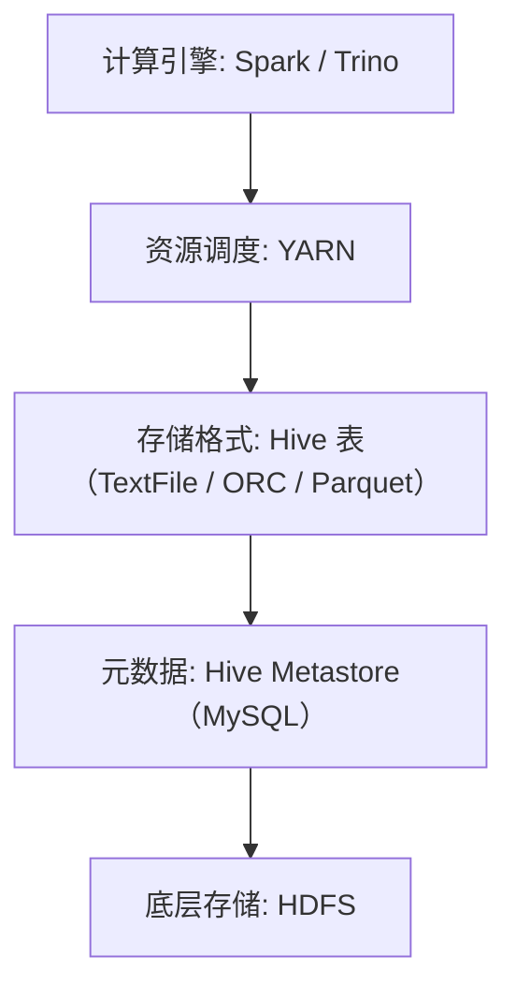
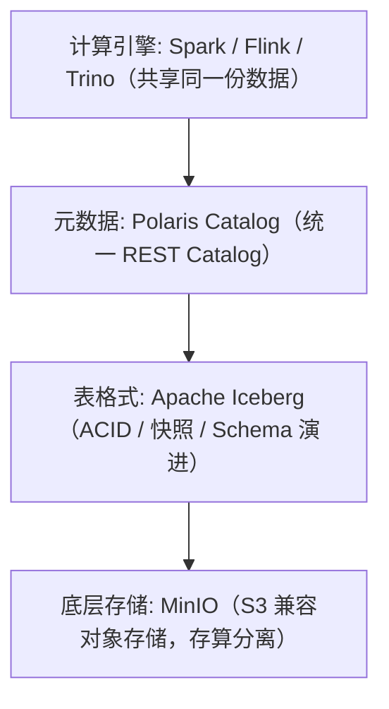

# 离线数仓向湖仓一体架构改造说明文档

## 一、架构概览

### 1.1 现有离线数仓架构



**数据流向**：业务库/日志 → 数据采集（Sqoop/Flume/DataX）→ HDFS（ODS/DWD/DWS/ADS 分层）→ Hive 表 → Spark 批处理 ETL → Trino/报表工具查询

### 1.2 目标湖仓一体架构



**数据流向**：业务库/日志/流数据 → Flink CDC/Kafka → Iceberg 表（MinIO）→ Polaris 统一元数据 → Spark/Flink/Trino 按需查询

---

## 二、现有离线数仓的痛点

### 2.1 数据时效性差，T+1 瓶颈明显

- 离线链路以**小时级/天级批处理**为主，业务方当天看不到当天的数据；
- 为了弥补时效性，往往需要额外搭建一套实时链路（Lambda 架构），导致**批流两套代码、两套存储**，口径对齐成本极高；
- Hive 表不支持高效的行级更新，CDC 增量同步通常只能"先落地明细、再全量重算合并"，延迟进一步放大。

### 2.2 Hive 表格式的结构性缺陷

| 缺陷                 | 具体表现                                 |
| ------------------ | ------------------------------------ |
| **无 ACID 保证**      | 并发写入/读写互相干扰，任务失败产生脏数据，需人工修复          |
| **更新删除代价高**        | 修改一行数据需要重写整个分区，GDPR 删除、订单状态更新等场景极其低效 |
| **分区模型僵化**         | 分区是物理目录结构，按天分区后想按小时查询、变更分区粒度都要重建表    |
| **小文件问题**          | 高频写入/流式写入产生大量小文件，NameNode 压力大、查询性能骤降 |
| **Schema 演进困难**    | 加列、改列类型在不同引擎间行为不一致，容易读出脏数据           |
| **无快照隔离**          | 查询过程中底层文件被改写，结果不可预期                  |
| **无法 Time Travel** | 误删/误写后数据无法回溯，只能靠备份恢复                 |

### 2.3 存储与计算耦合，成本高、弹性差

- HDFS **存算一体**，扩容存储必须同时扩容 DataNode 机器（连带 CPU/内存），资源利用率低；
- 数据默认 3 副本，**存储放大系数 3 倍**，冷数据成本居高不下；
- YARN 集群资源固定，潮汐现象明显：白天查询空闲、夜里批处理排队，**资源无法弹性伸缩**；
- 多集群/多机房之间数据搬迁困难，形成数据孤岛。

### 2.4 元数据管理瓶颈

- Hive Metastore 基于 MySQL，超大规模分区（百万级）下**元数据查询慢、锁竞争严重**；
- 表/分区元数据与实际文件**靠约定维持一致**，引擎或任务异常时容易产生"幽灵文件"；
- Spark 与 Trino 对 Hive 元数据的缓存策略不同，经常出现"一边改了另一边看不到"的一致性问题。

### 2.5 数据冗余与孤岛

- 同一份数据在不同团队、不同集群间反复拷贝，**存储浪费且口径不一**；
- ODS → DWD → DWS → ADS 每层都是物理拷贝，链路越长、数据越陈旧、血缘越难追。

---

## 三、湖仓一体如何解决上述痛点

### 3.1 Iceberg 表格式：根治 Hive 结构性缺陷

| Hive 痛点   | Iceberg 的解法                                                                                                  |
| --------- | ------------------------------------------------------------------------------------------------------------ |
| 无 ACID    | **快照级 ACID**：写提交基于乐观锁的原子元数据切换，读写互不干扰                                                                         |
| 更新删除代价高   | 支持**行级 UPDATE/DELETE/MERGE INTO**（Copy-on-Write / Merge-on-Read），CDC 同步可直接 MERGE                             |
| 分区僵化      | **隐藏分区（Hidden Partitioning）**：分区是元数据逻辑，支持分区演进（如按天→按小时）**无需重建表**                                              |
| 小文件       | 元数据层面管理文件清单，可结合 **Compaction**（重写小文件）后台治理，且查询按文件级统计信息剪枝，对小文件不如 Hive 敏感                                       |
| Schema 演进 | 完整的 **Schema Evolution**：加列/删列/改名/改类型/调整顺序，各引擎行为一致                                                           |
| 无快照隔离     | 每次提交生成**不可变快照**，查询固定在某个快照上，结果可复现                                                                             |
| 无法回溯      | **Time Travel**：`SELECT * FROM t VERSION AS OF ...` 或 `TIMESTAMP AS OF`，秒级回滚误操作（`CALL rollback_to_snapshot`） |

**对时效性的提升**：Iceberg 支持 **Flink 流式写入 + 增量读取（Incremental Read）**，湖上数据可以做到**分钟级新鲜度**，批流可以共用同一张 Iceberg 表，逐步淘汰 Lambda 双链路，走向 **Kappa/批流一体**。

### 3.2 MinIO 对象存储：存算分离、降本增效

- **存算分离**：存储（MinIO 集群）与计算（Spark/Flink/Trino 集群）独立扩缩容，计算资源可以按需弹性甚至使用抢占式实例；
- **纠删码（Erasure Coding）替代 3 副本**：存储放大系数从 3.0 降至约 **1.3~1.5**，冷数据成本大幅下降；
- **容量近乎无限**：摆脱 NameNode 内存瓶颈（对象存储无目录树 inode 压力），小文件对存储层不再是系统性风险；
- **S3 兼容协议**：所有主流引擎/工具（Spark、Flink、Trino、Dremio、StarRocks、AI 框架）原生支持，生态打通；
- 天然支持多租户 bucket 隔离、版本控制、生命周期管理（冷热分层、自动过期）。

### 3.3 Polaris Catalog：统一元数据与权限

- **REST 接口的开放 Catalog**，替代 Hive Metastore 的 Thrift + MySQL 私有协议；
- Spark / Flink / Trino **挂载同一个 Polaris Catalog，看到同一份表元数据**，一处提交、处处可见，彻底解决引擎间一致性问题；
- 支持**多 Catalog 联邦**（可挂载外部 Hive Metastore、JDBC 源），为迁移期提供平滑过渡；
- 集中式的**命名空间与权限管理**（RBAC），跨引擎统一授权，不再需要在每个引擎单独配置权限；
- 元数据即服务，规避了 MySQL 元数据瓶颈与主从一致性问题。

### 3.4 批流一体：一份数据、一套口径

- Flink CDC 实时入湖（分钟级）+ Spark 离线批处理**写同一张 Iceberg 表**；
- 明细层数据实时可见，离线的汇总层可以基于增量读取做**增量计算**，无需全量重刷；
- 业务口径只维护一份，彻底消除批流两套逻辑的对齐成本。

---

## 四、湖仓一体的其他优势

### 4.1 数据只存一份（Single Source of Truth）

- 同一张 Iceberg 表同时被 Spark（ETL/ML）、Flink（实时）、Trino（交互式分析/BI）直接访问，**消除跨引擎、跨团队的数据拷贝**；
- 分层（ODS→DWD→DWS→ADS）可以更多采用**逻辑视图/物化视图**替代物理拷贝，链路更短、数据更新鲜。

### 4.2 数据版本化与 DataOps

- 快照天然带来"类 Git"能力：可以打**标签（Tag）**固化发布版本、创建**分支（Branch）**做隔离实验（如 WAP 模式：Write-Audit-Publish，先写分支、审计通过后发布）；
- 数据质量稽核可以在分支上进行，不合格数据不会污染生产视图。

### 4.3 开放生态，避免厂商锁定

- Iceberg、Polaris、MinIO 均为**开源/开放协议**组件，表格式有完善的开放规范，未来接入新引擎（Doris、StarRocks、ClickHouse、Ray 等）零迁移成本；
- 对象存储是云原生事实标准，后续上云/混合云平滑演进。

### 4.4 更强的数据治理能力

- 统一 Catalog 下，表级血缘、权限、审计、数据目录（Data Discovery）可以集中建设；
- Puffin 等扩展支持在元数据中存储**统计信息、索引、甚至数据质量报告**。

### 4.5 查询性能优化手段更丰富

- 元数据级别的**文件剪枝**（min/max 统计 + 谓词下推）比 Hive 分区裁剪粒度细得多；
- 支持 **Z-Order / Sort / Bucket** 等数据布局优化，点查和范围查询可跳过 90%+ 文件；
- 快照隔离使 Trino 等引擎可以安全地做**元数据缓存**，进一步降低规划开销。

---

## 五、对半结构化与非结构化数据的处理

### 5.1 半结构化数据：从"存字符串"到"原生建模"

**现状痛点**：Hive 体系下 JSON 日志通常以 STRING 整列存储，查询时用 `get_json_object` 解析——慢、无类型、无校验、无法下推过滤。

**湖仓方案**：

1. **原生嵌套类型**：Iceberg 完整支持 `STRUCT / LIST / MAP` 复杂类型，JSON 日志可建模为强类型嵌套列，Trino/Spark 可直接点查子字段（`event.user.id`），并享受列式存储的裁剪与压缩；
2. **Schema 演进适配字段漂移**：日志/事件字段频繁增删，Iceberg 的 Schema Evolution 允许 JSON 字段平滑增减，无需重建表；
3. **半结构化仍可选择性保留 JSON 字符串**：对极度多变的字段可保留原始 JSON 列兜底，冷热字段分离建模，兼顾灵活性与性能；
4. **格式统一**：原始 JSON/Avro 数据入湖后统一转 Parquet/ORC 列存，压缩率和查询性能提升数倍，同时保留原始快照可回溯。

### 5.2 非结构化数据：对象存储即天然载体

**现状痛点**：图片、音视频、文档、模型文件在 HDFS 体系中基本没有一席之地，只能另建文件存储，与分析链路完全割裂。

**湖仓方案**：

1. **MinIO 天然就是文件存储**：非结构化文件（图片/PDF/音视频/模型产物）直接以对象形式存放，享受纠删码、版本控制、生命周期管理；
2. **"元数据入表、文件入桶"模式**：用 Iceberg 表管理非结构化文件的元数据（路径、标签、业务属性、向量索引地址），通过 SQL 即可检索文件，例如：
   ```sql
   SELECT image_uri, label FROM catalog.ai.dataset WHERE split = 'train' AND quality_score > 0.9;
   ```
3. **AI/ML 场景打通**：
   - 训练框架（PyTorch/TF）通过 S3 协议**直接流式读取 MinIO**，无需数据搬迁；
   - 结合 Iceberg 快照实现**训练数据集版本化**（可复现的实验）；
   - 可向多模态湖仓演进：非结构化数据 + 嵌入向量 + 结构化标签统一管理，支撑 RAG、特征平台等场景；
4. **一份存储，两份用途**：同一份文件既服务于分析引擎，也服务于 AI 训练，消除"数据湖"与"AI 存储"的重复建设。

---

## 六、对计算引擎性能与资源的影响

### 6.1 查询性能：有升有降，整体显著优化

**提升项**：

| 优化点 | 说明 |
|--------|------|
| 文件级剪枝 | Iceberg 清单（manifest）携带每个文件的列级 min/max 统计，Trino/Spark 在规划阶段即可跳过无关文件，比 Hive 分区+目录列举**快一个数量级** |
| 无目录列举开销 | Hive 查询前要 `listFiles` 递归遍历 HDFS 目录（大表规划耗时分钟级）；Iceberg 直接读元数据清单，**规划时间从分钟级降到秒级** |
| 元数据可安全缓存 | 快照不可变，Trino 可放心缓存表元数据/文件统计，重复查询近乎零规划开销 |
| 数据布局优化 | 写入时 Sort/Z-Order 配合列存，点查、范围查询 IO 大幅下降 |
| 引擎共存各取所长 | Trino 做交互式查询、Spark 做重 ETL、Flink 做流处理，不再互相挤占 |

**需要正视的成本项**：

| 成本点 | 说明与对策 |
|--------|-----------|
| Merge-on-Read 读放大 | 高频更新产生的 delete file 会在读时合并。**对策**：合理配置 COW/MOR 策略 + 定期 Compaction |
| Compaction 常驻开销 | 需要后台任务合并小文件/清理过期快照（`rewrite_data_files` / `expire_snapshots`）。**对策**：独立的小规格维护集群，错峰运行 |
| 对象存储延迟 | 首字节延迟高于本地 HDFS，对小 IO 敏感。**对策**：引擎侧缓存（Trino 本地缓存/Alluxio）、增大 Parquet Row Group、批量读取 |
| 元数据服务可用性 | Polaris/REST Catalog 成为关键路径。**对策**：多副本部署 + 引擎侧缓存兜底 |

### 6.2 资源利用：从"固定烟囱"到"弹性共享"

1. **YARN 烟囱 → 独立弹性**：
   - 现有架构所有引擎挤在同一个 YARN 队列里互相抢占；
   - 新架构下计算集群（可以仍是 YARN/K8s/独立部署）与存储解耦，**查询集群白天扩容、夜里缩容**，批处理集群夜里弹性拉起，整体资源利用率显著提升；
2. **存储成本下降**：纠删码（~1.4x）替代三副本（3x），同等有效数据量存储占用**下降 50%+**；冷数据自动沉降低频介质；
3. **消除冗余拷贝**：一份数据多引擎共享 + 视图化分层，存储和重复计算的 ETL 资源同步节省；
4. **网络 IO 增加需评估**：存算分离后计算读数据走网络，需保证计算集群与 MinIO 间带宽（建议万兆+），热点数据用缓存对冲；
5. **Flink 常驻资源**：批流一体引入常驻流任务，占用一部分常驻资源，但换来的是替代掉原 Lambda 架构的整条实时链路，净收益为正。

### 6.3 迁移期建议（资源角度）

- Polaris 支持**挂载现有 Hive Metastore 做联邦查询**，迁移期新旧表可共存、可互相 JOIN；
- 建议按"**新链路先入湖 → 存量只读迁移（register/migrate）→ 双跑对数 → 切换下线**"四步走，避免一次性全量重写带来的资源洪峰。

---

## 七、总结

| 维度   | 现有离线数仓 (HDFS+YARN+Hive) | 湖仓一体 (Polaris+MinIO+Iceberg) |
| ---- | ----------------------- | ---------------------------- |
| 数据时效 | T+1 / 小时级               | 分钟级（流式入湖 + 增量计算）             |
| 数据更新 | 重写分区                    | 行级 ACID MERGE                |
| 存算架构 | 耦合、3 副本                 | 分离、纠删码 ~1.4x                 |
| 弹性能力 | 固定资源、潮汐浪费               | 按需扩缩容                        |
| 元数据  | Hive Metastore 瓶颈、引擎不一致 | Polaris 统一 REST Catalog、强一致  |
| 半结构化 | STRING + 运行时解析          | 原生嵌套类型 + Schema 演进           |
| 非结构化 | 体系外另建存储                 | 元数据入表 + 文件入桶，AI 直通           |
| 数据治理 | 分散、血缘难追                 | 统一 Catalog、快照版本化             |
| 生态   | 绑定 Hive 协议              | 开放标准，多引擎即插即用                 |

**结论**：本次改造以 Iceberg 表格式为核心解决 ACID、时效性与 Schema 演进问题，以 MinIO 存算分离解决成本与弹性问题，以 Polaris 统一 Catalog 解决一致性与治理问题，最终实现**一份数据、多引擎共享、批流一体、面向分析与 AI 双重负载**的现代数据底座。
